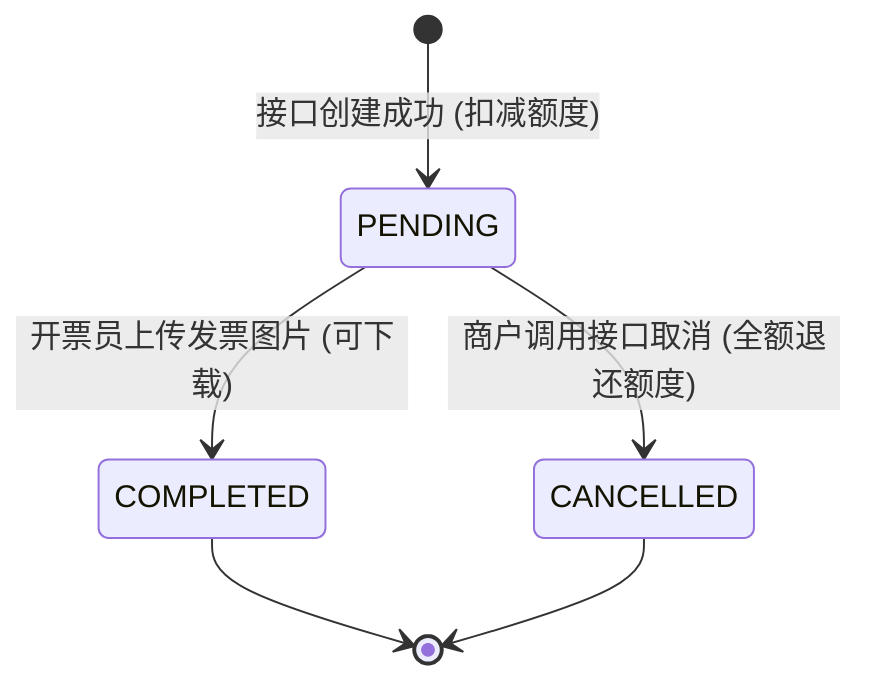
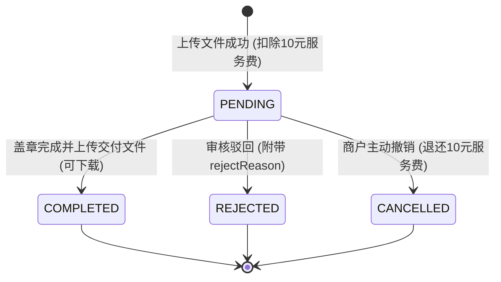

# BOBAPI 开放平台接口对接规范文档 (OpenAPI v1.0)

欢迎对接 **BOBAPI 发票与盖章管理系统** 开放接口！  
本文档面向外部商户、企业财务/ERP系统、自研中台等研发与系统对接人员，详细说明系统的通信协议、认证机制、业务规则、计费扣减模型、全量接口定义、异常处理标准以及典型编程语言的集成代码示例。

---

## 目录

- [1. 快速入门与接入准备](#1-快速入门与接入准备)
  - [1.1 接口基础信息](#11-接口基础信息)
  - [1.2 API Key 的获取与权限边界](#12-api-key-的获取与权限边界)
  - [1.3 通讯协议与通用规范](#13-通讯协议与通用规范)
- [2. 核心业务模型与计费扣减机制](#2-核心业务模型与计费扣减机制)
  - [2.1 发票预付费额度与扣减模型](#21-发票预付费额度与扣减模型)
  - [2.2 盖章独立服务费机制](#22-盖章独立服务费机制)
  - [2.3 状态流转与生命周期](#23-状态流转与生命周期)
  - [2.4 线上功能与 OpenAPI 范围说明](#24-线上功能与-openapi-范围说明)
- [3. 安全机制与高可用集成最佳实践](#3-安全机制与高可用集成最佳实践)
  - [3.1 外部商户订单号 (outTradeNo) 机制与对账](#31-外部商户订单号-outtradeno-机制与对账)
  - [3.2 幂等键 (Idempotency-Key) 机制与冲突处理](#32-幂等键-idempotency-key-机制与冲突处理)
  - [3.3 接口调用频率限制 (Rate Limit)](#33-接口调用频率限制-rate-limit)
  - [3.4 网络超时与重试建议](#34-网络超时与重试建议)
- [4. 全局返回格式与状态码规范](#4-全局返回格式与状态码规范)
  - [4.1 统一响应报文](#41-统一响应报文)
  - [4.2 业务状态码 (Code) 完整清单](#42-业务状态码-code-完整清单)
  - [4.3 典型错误响应示例](#43-典型错误响应示例)
- [5. API 接口详细说明](#5-api-接口详细说明)
  - [5.1 额度查询接口](#51-额度查询接口)
    - [5.1.1 查询发票账户额度](#511-查询发票账户额度)
  - [5.2 发票管理接口](#52-发票管理接口)
    - [5.2.1 提交单笔开票申请](#521-提交单笔开票申请)
    - [5.2.2 批量提交开票申请 (最多100条/512KB)](#522-批量提交开票申请-最多100条512kb)
    - [5.2.3 按内部 ID 查询发票详情](#523-按内部-id-查询发票详情)
    - [5.2.4 按外部单号 (outTradeNo) 查询发票详情](#524-按外部单号-outtradeno-查询发票详情)
    - [5.2.5 按内部 ID 取消开票申请](#525-按内部-id-取消开票申请)
    - [5.2.6 按外部单号 (outTradeNo) 取消开票申请](#526-按外部单号-outtradeno-取消开票申请)
    - [5.2.7 按内部 ID 下载已开发票文件](#527-按内部-id-下载已开发票文件)
    - [5.2.8 按外部单号 (outTradeNo) 下载已开发票文件](#528-按外部单号-outtradeno-下载已开发票文件)
  - [5.3 文件盖章接口](#53-文件盖章接口)
    - [5.3.1 上传待盖章文件 (Multipart)](#531-上传待盖章文件-multipart)
    - [5.3.2 查询盖章文件列表](#532-查询盖章文件列表)
    - [5.3.3 撤销待盖章申请 (退还服务费)](#533-撤销待盖章申请-退还服务费)
    - [5.3.4 下载已盖章完成的文件](#534-下载已盖章完成的文件)
- [6. 多语言对接代码示例](#6-多语言对接代码示例)
  - [6.1 Python 完整客户端示例](#61-python-完整客户端示例)
  - [6.2 Java 17+ 示例 (HttpClient + Jackson)](#62-java-17-示例-httpclient--jackson)
  - [6.3 Node.js 示例 (Axios)](#63-nodejs-示例-axios)
  - [6.4 cURL 命令行调用](#64-curl-命令行调用)
  - [6.5 上线前对接自检清单](#65-上线前对接自检清单)
- [7. 常见问题排查与技术支持 (FAQ)](#7-常见问题排查与技术支持-faq)

---

## 1. 快速入门与接入准备

### 1.1 接口基础信息

| 配置项 | 说明 |
| :--- | :--- |
| **测试环境网关地址** | `http://<测试环境Host:Port>/api`（请联系平台管理员索取） |
| **生产环境网关地址** | `https://<生产环境域名>/api` |
| **OpenAPI 统一路径前缀** | `/api/open/v1` |
| **认证 Header** | `X-API-KEY: <您的API_KEY>`（大小写不敏感，亦支持 `X-Api-Key`） |
| **数据传输协议** | HTTPS / HTTP 1.1，字符集 `UTF-8`，报文内容格式 `application/json`（文件上传除外） |

> **⚠️ 重点注意：**
> 系统根路径配置了 `/api` 上下文。所有接口的完整请求路径必须以 `/api` 开头，例如创建发票的完整 URL 是：`https://<域名>/api/open/v1/invoices`。

### 1.2 API Key 的获取与权限边界

1. **获取途径**：
   - 商户用户登录 BOBAPI 发票系统 Web 界面，进入【个人中心】或【API Key 管理】。
   - 点击【生成 API Key】生成专属密钥，或由平台管理员在后台为该商户分配生成。
2. **权限隔离与安全**：
   - 每一个 API Key 与商户账户严格一对一绑定。通过该 Key 只能访问和操作**当前账号自身名下**的数据，无法跨租户越权（违规访问返回 `403`）。
   - API Key **仅在 `/api/open/**` 开放路径下生效**。若携带 API Key 请求后台管理接口或站内接口，将直接被安全过滤器拦截并按未登录处理（`401`）。
   - **安全建议**：严禁在前端 JavaScript、移动端 App 或公开仓库中明文硬编码 API Key，务必部署在后端服务端环境变量中。

### 1.3 通讯协议与通用规范

- **全链路追踪**：每次 HTTP 请求，系统会在响应报文的 `traceId` 字段以及 HTTP 响应头 `X-Trace-Id` 中返回唯一的 UUID。对接调试中遇到任何报错，可直接复制此追踪 ID 提交给平台支持人员。
- **金额精度与类型**：所有涉及金额的入参和出参，均以 **元（RMB）** 为单位，强制保留不超过两位小数（如 `100.00`），禁止使用浮点数，建议使用精确的字符串或 `BigDecimal` 序列化表示。单笔开票接口的 `amount` 同时接受 JSON 数字（`1000.00`）与字符串（`"1000.00"`），批量接口的 `amount` 为字符串。
- **严格字段校验**：请求体中**不允许出现文档未定义的字段**（含拼写错误，如把 `specification` 写成 `spec`），否则整个请求返回 `400`，业务码 `40001`，提示「请求体格式不正确」。

---

## 2. 核心业务模型与计费扣减机制

### 2.1 发票预付费额度与扣减模型

系统采用**先充值额度、后提开发票**的预付费模型。

#### 1. 额度折算基准
商户充值时采用 **3%（0.03）** 的基准手续费率反算可开票额度：
$$\text{获得额度} = \frac{\text{充值手续费}}{0.03} \quad (\text{向下取整到分})$$
*例如：对公转账支付手续费 30.00 元，平台管理员审核通过后，商户发票额度账户将到账 1,000.00 元。*

#### 2. 开票扣减额度规则
系统支持指定 **出票主体公司（`sellerCompany`）** 与 **发票票种（`invoiceCategory`）**，不同的组合对应不同的执行费率及实际扣除额度倍率：

| 出票主体 (`sellerCompany`) | 发票票种 (`invoiceCategory`) | 执行费率 | 额度扣除倍率计算公式 | 举例：申请开票 1,000.00 元 |
| :--- | :--- | :---: | :--- | :--- |
| **普通公司** (`DEFAULT`, 默认) | **普通发票** (`NORMAL`, 默认) | 3% (`0.0300`) | $\text{扣除额度} = \text{开票金额} \times 1.0$ | 扣除 **1,000.00** 额度 |
| **普通公司** (`DEFAULT`, 默认) | **增值税专用发票** (`VAT_SPECIAL`) | 9% (`0.0900`) | $\text{扣除额度} = \text{开票金额} \times 3.0$ | 扣除 **3,000.00** 额度 |
| **科技公司** (`TECH`) | **普通发票** (`NORMAL`, 默认) | 4% (`0.0400`) | $\text{扣除额度} = \text{开票金额} \times \frac{0.04}{0.03}$ | 扣除 **1,333.33** 额度 |
| **科技公司** (`TECH`) | **增值税专用发票** (`VAT_SPECIAL`) | 10% (`0.1000`) | $\text{扣除额度} = \text{开票金额} \times \frac{0.10}{0.03}$ | 扣除 **3,333.33** 额度 |

#### 3. 额度扣减与退还时机
- **扣减**：开票申请创建成功时，数据库行锁校验余额并**实时原子扣除**。若可用额度不足，事务完整回滚并返回 `40002`，不产生脏数据。
- **退还**：当发票处于 `PENDING`（待开票）状态时，商户通过接口或界面取消申请，系统**原路退还**创建时实际扣除的额度。

### 2.2 盖章独立服务费机制

- 盖章业务使用**独立的盖章额度账户**，与发票额度物理隔离。
- 单次上传待盖章文件固定扣除单次服务费 **10.00 元**。
- 仅当盖章申请处于 `PENDING` 状态时撤销，系统会自动退还 10.00 元服务费。
- 为保护商户隐私，OpenAPI 不暴露盖章额度余额查询，若上传时盖章额度不足，仅返回 `40002 盖章额度不足，请先充值`。

### 2.3 状态流转与生命周期

#### 发票业务状态流转 (`status`)

- `PENDING`（待开票）：申请已接收，额度已预扣，等待开票员开具发票。在此状态下**允许调用取消接口**。
- `COMPLETED`（已开票）：开票员已上传发票文件凭证（JPG/PNG）。此时字段 `downloadable = true`，商户可调用下载接口。**已开票状态不可取消**。
- `CANCELLED`（已取消）：开票申请已被撤回，对应额度已退还商户。

#### 盖章文件状态流转 (`status`)


### 2.4 线上功能与 OpenAPI 范围说明

- **发票红冲 (`redFlushStatus`)**：发票红冲涉及原票作废及税务核验，当前仅支持商户在 Web 界面人工发起。OpenAPI 的发票查询接口返回 `redFlushStatus`（`NONE` / `PENDING` / `COMPLETED` / `REJECTED`），便于客户系统感知红冲状态。
- **标记已处理 (`isProcessed`)**：属于 Web 界面用户端的数据筛选标记，不作为 OpenAPI 状态控制。

---

## 3. 安全机制与高可用集成最佳实践

### 3.1 外部商户订单号 (outTradeNo) 机制与对账

强烈建议在提交单笔发票申请时，传入客户系统自身的业务单号：`outTradeNo`（最大 100 字符）。
1. **全局唯一与防重**：数据库底层为 `(user_id, out_trade_no)` 建立了唯一索引。
2. **重试透明幂等**：若因网络抖动造成调用方未收到响应而发起重试，只要 `outTradeNo` 及请求报文内容完全一致，系统不会重复建单扣费，而是**直接返回初次创建成功的发票记录**。
3. **闭环操作能力**：系统针对 `outTradeNo` 提供了**查询状态**、**取消申请**、**下载发票**专属接口，商户系统无需本地持久化 BOBAPI 内部的自增发票 ID。

### 3.2 幂等键 (Idempotency-Key) 机制与冲突处理

系统通过请求头 `Idempotency-Key` 提供强幂等保护：
- **格式规范**：长度 16 ~ 64 位，字符集仅限数字、字母、点、下划线、冒号和连字符（正则：`^[A-Za-z0-9._:-]{16,64}$`）。
- **约束机制**：
  - 盖章文件上传接口（`POST /open/v1/documents`）**强制必传**此 Header。
  - 发票创建接口推荐传递。若未传，系统将自动使用 `open_<outTradeNo>` 作为幂等键兜底。
  - ⚠️ **`Idempotency-Key` 与 `outTradeNo` 都不传时，系统为每次请求生成随机幂等键，此时请求不具备任何防重能力**：超时后重试会创建新的申请并再次扣减额度。生产环境请至少传入其中之一。
  - 批量接口未传 `Idempotency-Key` 时同样会生成随机键，整批重试会重复建单，建议每个批次固定一个幂等键。
- **重复请求的内容比对**：命中已有记录（相同 `outTradeNo` 或相同幂等键）时，系统会比对以下字段：`companyName`、`taxNumber`、`specification`、`unit`、`amount`、`invoiceType`、`invoiceCategory`、`sellerCompany`。全部一致则直接返回首次创建的记录（不重复扣费）；任一字段不一致则返回 `40902`。`remark` 不参与比对。
- **冲突判断与错误码**：
  - **内容被篡改**：同一商户使用相同的幂等键提交了不同的请求内容（金额、公司名称等不一致），系统抛出 HTTP `409 Conflict`（业务 Code: `40902` 发票，`40903` 盖章）。
  - **并发到达**：毫秒级同时到达的同幂等键并发请求，系统利用唯一索引排他防护，后到达的请求返回 `409`（业务 Code: `40904`），调用方稍候查询即可。

### 3.3 接口调用频率限制 (Rate Limit)

系统采用滑动窗口算法对商户维度进行频控防护。触发限流时返回 HTTP `429 Too Many Requests`，响应报文附带 `data`（需等待重试的秒数），同时响应头中附带标准 `Retry-After: <秒数>`。

| 接口分类 | 接口路径与方法 | 频控阈值 | 限流错误码 |
| :--- | :--- | :--- | :--- |
| **单笔发票提交** | `POST /api/open/v1/invoices` | **60 次 / 分钟** | `42902` |
| **批量发票提交** | `POST /api/open/v1/invoices/batch` | **20 次 / 分钟** | `42902` |
| **发票状态查询** | `GET /api/open/v1/invoices/*` | **120 次 / 分钟** | `42905` |
| **发票文件下载** | `GET /api/open/v1/invoices/*/download` | **120 次 / 分钟** | `42904` |
| **发票申请取消** | `POST /api/open/v1/invoices/*/cancel` | **30 次 / 分钟** | `42905` |
| **发票额度查询** | `GET /api/open/v1/quota` | **120 次 / 分钟** | `42907` |
| **盖章文件上传** | `POST /api/open/v1/documents` | **30 次 / 分钟** | `42901` |
| **盖章列表查询** | `GET /api/open/v1/documents` | **120 次 / 分钟** | `42905` |
| **盖章申请撤销** | `POST /api/open/v1/documents/{id}/cancel` | **30 次 / 分钟** | `42905` |
| **盖章交付下载** | `GET /api/open/v1/documents/{id}/download` | **120 次 / 分钟** | `42904` |

### 3.4 网络超时与重试建议

1. **客户端超时配置**：建议连接超时（Connect Timeout）设为 **5~10 秒**，读取超时（Read Timeout）设为 **15~30 秒**。
2. **发生超时时的正确做法**：
   - 当调用提交接口遭遇 SocketTimeoutException 或 HTTP 504 错误时，**切勿生成新的订单号重新调用**（否则可能导致多次扣额）。
   - 正确做法：使用原 `outTradeNo` 调用【按商户单号查询发票】接口：
     - 若已查到记录，说明前次请求已成功建单，直接使用；
     - 若返回 404，说明前次请求未到达系统，可使用原 `outTradeNo` 安全重试。

---

## 4. 全局返回格式与状态码规范

### 4.1 统一响应报文

除二进制流下载接口直接传输文件字节外，系统所有响应均采用统一的 JSON 包装：

```json
{
  "code": 200,
  "message": "success",
  "data": {},
  "traceId": "9f7b4946-b33a-44c1-845b-7b08219ab12e"
}
```

- `code`：业务状态码（整数），`200` 表示操作成功，非 200 详见下表。
- `message`：提示信息。
- `data`：响应载荷（对象、数组、基本数据类型或 null）。
- `traceId`：全局调用链追踪唯一标识。

### 4.2 业务状态码 (Code) 完整清单

| HTTP 状态 | 业务 Code | 说明与典型触发原因 | 处理策略 |
| :--- | :--- | :--- | :--- |
| `200 OK` | `200` | 操作成功 | 正常处理业务载荷 |
| `400 Bad Request` | `40001` | 参数校验不通过（缺失必填参数、参数格式或长度超出限制） | 检查并修正入参字段 |
| `400 Bad Request` | `40002` | 账户额度不足（发票可用额度不足，或盖章额度不足） | 前往平台充值额度 |
| `400 Bad Request` | `40003` | 业务字段规则非法（如开票类型不在允许白名单内、开票金额超过10位整数） | 检查发票票种、开票类型枚举 |
| `400 Bad Request` | `40007` | 上传了危险扩展名文件（包含 `.exe`, `.bat`, `.sh`, `.php` 等脚本或可执行文件） | 更换为合规的办公或图片文件 |
| `401 Unauthorized`| `40100` | 未提供身份凭证 | 检查请求是否带上认证信息 |
| `401 Unauthorized`| `40101` | 缺少 `X-API-KEY` 请求头，或 API Key 不存在/已被禁用 | 检查 Header 拼写并在控制台启用 Key |
| `403 Forbidden`   | `40300` | 权限拒绝 / 跨租户数据越权访问 | 禁止尝试操作其他商户账号的数据 |
| `403 Forbidden`   | `40301` | 资源归属校验失败（试图下载或取消其他账号的发票） | 确认请求所操作的单号归属自身 |
| `404 Not Found`   | `40401` | 发票申请记录或盖章记录不存在 | 检查查询的发票 ID 或商户订单号 |
| `404 Not Found`   | `40402` | 发票物理文件不存在或未上传完成 | 等待发票状态流转至 COMPLETED 再下载 |
| `409 Conflict`    | `40900` | 数据库并发乐观锁冲突 | 重新刷新数据后发起操作 |
| `409 Conflict`    | `40902` | 幂等冲突（发票 Idempotency-Key 已用于不同内容，或该单已被处理无法取消） | 检查是否篡改了重复提交的报文内容 |
| `409 Conflict`    | `40903` | 盖章 Idempotency-Key 已用于不同文件 | 为新文件生成全新 Idempotency-Key |
| `409 Conflict`    | `40904` | 相同 Idempotency-Key 的上传请求正在处理中 | 稍候调用列表接口查询上传结果 |
| `413 Payload Large`| `41300` | 单文件体积超限（发票上传限 10MB，盖章上传限 50MB） | 压缩后重新上传 |
| `413 Payload Large`| `41302` | 批量开票请求体 JSON 体积超过 **512KB** 限制 | 减少单次批量提交的记录数量 |
| `422 Unprocessable`| `42201` | 实体状态不支持该操作（例如：只能取消 PENDING 状态发票） | 确认发票当前状态是否满足前置条件 |
| `422 Unprocessable`| `42202` | 批量开票数据包含明细行校验错误（逐行校验失败） | 查看 `data` 数组中定位出错行与字段 |
| `429 Too Many Req`| `42901`~`42907` | 触发接口频控限制 | 获取响应中秒数，延迟后发起重试 |
| `500 Server Error`| `50000` | 系统处理异常 | 保留 `traceId` 联系平台技术人员 |

### 4.3 典型错误响应示例

所有错误都使用 4.1 的统一结构，HTTP 状态码与 `code` 同时生效。客户端应先判断 HTTP 状态码，再读取 `code` 与 `message`。

**额度不足（HTTP 400）**：
```json
{
  "code": 40002,
  "message": "额度不足，当前余额：200.00，需要：500.00",
  "data": null,
  "traceId": "fa9d2b2c-3491-4d79-9014-5efc1c911001"
}
```

**API Key 缺失或无效（HTTP 401）**：
```json
{
  "code": 40101,
  "message": "API Key 无效或未启用",
  "data": null,
  "traceId": "0d5c6f9e-0a52-4f43-9c0e-2b8f3b7c6a11"
}
```

**幂等冲突：同一单号/幂等键提交了不同内容（HTTP 409）**：
```json
{
  "code": 40902,
  "message": "Idempotency-Key 已用于其他发票申请",
  "data": null,
  "traceId": "48b1d40c-e208-4c6c-99a6-d36e2f7b4946"
}
```

**状态不允许操作：取消已开票的发票（HTTP 422）**：
```json
{
  "code": 42201,
  "message": "只能取消待开票的发票申请",
  "data": null,
  "traceId": "3e2a8a51-7f3b-4c1d-a8a0-6f5a3c9b2d10"
}
```

**触发限流（HTTP 429，响应头 `Retry-After: 18`）**：`data` 为建议等待的秒数。
```json
{
  "code": 42902,
  "message": "发票申请提交过于频繁，请稍后再试",
  "data": 18,
  "traceId": "79b32943-4dc3-4a16-9285-1adbe3ce8c97"
}
```

> 下载类接口（`.../download`）成功时返回文件二进制流；**失败时返回的仍是上述 JSON**（如 `40401` 记录不存在、`40402` 发票文件不存在），客户端请先判断 HTTP 状态码为 `200` 再写入文件，避免把错误 JSON 保存成图片。

---

## 5. API 接口详细说明

### 5.1 额度查询接口

#### 5.1.1 查询发票账户额度

- **接口描述**：获取当前商户账号名下的发票额度余额、累计充值总额与累计消耗总额。
- **请求方式**：`GET`
- **请求路径**：`/api/open/v1/quota`
- **请求头**：
  - `X-API-KEY`：`string`（必填）

**响应示例**：
```json
{
  "code": 200,
  "message": "success",
  "data": {
    "balance": 52300.50,
    "totalRecharged": 100000.00,
    "totalDeducted": 47699.50
  },
  "traceId": "fa9d2b2c-3491-4d79-9014-5efc1c911001"
}
```

---

### 5.2 发票管理接口

#### 5.2.1 提交单笔开票申请

- **接口描述**：提交单张发票开具申请。系统实时原子校验额度并扣除。
- **请求方式**：`POST`
- **请求路径**：`/api/open/v1/invoices`
- **请求头**：
  - `X-API-KEY`：`string`（必填）
  - `Idempotency-Key`：`string`（可选，推荐传，16~64位）
  - `Content-Type`：`application/json`
- **请求体参数 (JSON Body)**：

| 字段名 | 类型 | 必填 | 默认值 | 约束说明 |
| :--- | :--- | :---: | :--- | :--- |
| `outTradeNo` | String | 否 | 无 | 外部商户订单号，同账号下唯一，最大 100 字符。**强烈推荐传入** |
| `companyName`| String | **是** | 无 | 开票抬头（购买方公司名称），最大 200 字符，不能为空 |
| `taxNumber`  | String | 否 | 无 | 纳税人识别号（税号），最大 100 字符，自动去除首尾空格并转大写 |
| `specification` | String | 否 | 无 | 规格型号，最大 100 字符，自动去除首尾空格，留空视为未填写 |
| `unit`       | String | 否 | 无 | 单位（如 项、次、套），最大 20 字符，自动去除首尾空格，留空视为未填写 |
| `amount`     | BigDecimal | **是** | 无 | 开票金额（元），最小 `0.01`，最多 10 位整数和 2 位小数 |
| `invoiceType`| String | 否 | `技术服务费` | 开票类型。**严格白名单校验**，仅支持：<br>• `技术服务费`<br>• `AI订阅服务费`<br>• `计算服务费`<br>• `研发和技术服务`<br>• `信息系统服务`<br>• `AI算力` |
| `invoiceCategory`| String | 否 | `NORMAL` | 发票票种：<br>• `NORMAL`：普通发票（普票）<br>• `VAT_SPECIAL`：增值税专用发票（专票）<br>*(支持中文别名“普票/普通发票”、“专票/专用发票”)* |
| `sellerCompany` | String | 否 | `DEFAULT` | 出票主体公司：<br>• `DEFAULT`：普通公司（默认，普票1倍/专票3倍额度）<br>• `TECH`：科技公司（普票4/3倍/专票10/3倍额度）<br>*(支持中文别名“普通公司”、“科技公司”)* |
| `remark`     | String | 否 | 无 | 发票备注信息，最大 500 字符 |

**请求体示例**：
```json
{
  "outTradeNo": "ORDER_20261031_0001",
  "companyName": "北京科技有限公司",
  "taxNumber": "91110108MA00000000",
  "specification": "标准版",
  "unit": "项",
  "amount": 1000.00,
  "invoiceType": "技术服务费",
  "invoiceCategory": "NORMAL",
  "sellerCompany": "DEFAULT",
  "remark": "项目一期开发技术服务费"
}
```

**响应示例**：
```json
{
  "code": 200,
  "message": "申请成功",
  "data": {
    "id": 1024,
    "outTradeNo": "ORDER_20261031_0001",
    "companyName": "北京科技有限公司",
    "taxNumber": "91110108MA00000000",
    "specification": "标准版",
    "unit": "项",
    "amount": 1000.00,
    "invoiceType": "技术服务费",
    "invoiceCategory": "NORMAL",
    "sellerCompany": "DEFAULT",
    "feeRate": 0.0300,
    "deductedQuota": 1000.00,
    "remark": "项目一期开发技术服务费",
    "status": "PENDING",
    "submissionType": "API",
    "redFlushStatus": "NONE",
    "redFlushReason": null,
    "redFlushRemark": null,
    "redFlushApplyTime": null,
    "redFlushCompleteTime": null,
    "downloadable": false,
    "fileName": null,
    "createdAt": "2026-10-31T12:00:00",
    "completedAt": null
  },
  "traceId": "79b32943-4dc3-4a16-9285-1adbe3ce8c97"
}
```

---

#### 5.2.2 批量提交开票申请 (最多100条/512KB)

- **接口描述**：单次批量提交多张发票申请。具有**全局原子性**：批次中若任一行字段校验失败或商户总额度不足，**整批全部回滚**，不产生部分写入。
- **请求方式**：`POST`
- **请求路径**：`/api/open/v1/invoices/batch`
- **体积限制**：JSON 请求体大小不能超过 **512KB**（超限返回 `41302`）。
- **数量限制**：`items` 数组长度为 **1 ~ 100 条**（超限返回 `40001`）。
- **请求头**：
  - `X-API-KEY`：`string`（必填）
  - `Idempotency-Key`：`string`（可选，用于整批防重）
  - `Content-Type`：`application/json`
- **请求体参数**：

| 字段名 | 类型 | 必填 | 默认值 | 说明 |
| :--- | :--- | :---: | :--- | :--- |
| `duplicateInvoiceRequest` | Boolean | 否 | `false` | **重要开关**：同一批次内是否存在相同抬头与金额的发票。<br>• 设为 `false` 时：若批次内存在两行明细的内容完全一致，将报错 `该行与批次内其他行完全重复`；<br>• 设为 `true` 时：允许合法重复开票。 |
| `items` | Array | **是** | 无 | 发票明细对象列表（1 ~ 100 条） |

`items` 数组元素字段：
- `rowNumber`（Integer，可选）：客户端行号。若传入，必须 $\ge 1$ 且**批次内不可重复**。若不传，系统默认从 1 自增赋值。
- `companyName`（String，必填）：公司名称（$\le 200$ 字符）。
- `taxNumber`（String，可选）：纳税人识别号（$\le 100$ 字符）。
- `specification`（String，可选）：规格型号（$\le 100$ 字符）。
- `unit`（String，可选）：单位（$\le 20$ 字符）。
- `amount`（String，必填）：金额文本格式（如 `"1500.00"`），最多 10 位整数和 2 位小数。
- `invoiceType`（String，可选，默认 `技术服务费`）：开票类型白名单。
- `invoiceCategory`（String，可选，默认 `NORMAL`）：`NORMAL` 普票 / `VAT_SPECIAL` 专票。
- `sellerCompany`（String，可选，默认 `DEFAULT`）：`DEFAULT` 普通公司 / `TECH` 科技公司。
- `remark`（String，可选）：备注（$\le 500$ 字符）。

> 批量明细**不支持 `outTradeNo`**。请保存成功响应中每行的 `items[].invoiceId`，后续通过「按内部 ID」系列接口（5.2.3 / 5.2.5 / 5.2.7）查询、取消与下载。

**请求体示例**：
```json
{
  "duplicateInvoiceRequest": false,
  "items": [
    {
      "rowNumber": 1,
      "companyName": "腾讯科技（深圳）有限公司",
      "taxNumber": "91440300708461136T",
      "specification": "标准版",
      "unit": "项",
      "amount": "5000.00",
      "invoiceType": "技术服务费",
      "invoiceCategory": "NORMAL",
      "sellerCompany": "DEFAULT"
    },
    {
      "rowNumber": 2,
      "companyName": "阿里巴巴（中国）网络技术有限公司",
      "taxNumber": "91330100716105852F",
      "amount": "2000.00",
      "invoiceType": "计算服务费",
      "invoiceCategory": "VAT_SPECIAL",
      "sellerCompany": "TECH"
    }
  ]
}
```

**成功响应示例 (`200 OK`)**：
```json
{
  "code": 200,
  "message": "批量申请成功",
  "data": {
    "batchId": 88,
    "total": 2,
    "successCount": 2,
    "failureCount": 0,
    "totalAmount": "7000.00",
    "items": [
      { "rowNumber": 1, "invoiceId": 1025, "status": "SUCCESS", "message": "申请成功" },
      { "rowNumber": 2, "invoiceId": 1026, "status": "SUCCESS", "message": "申请成功" }
    ]
  },
  "traceId": "9b12d7c0-141b-4e54-8545-80bf70f6cb3c"
}
```

**批量校验失败响应示例 (`422 Unprocessable Entity`)**：
```json
{
  "code": 42202,
  "message": "批量申请包含无效数据",
  "data": [
    {
      "rowNumber": 2,
      "field": "amount",
      "code": 42202,
      "message": "开票金额格式不正确，应为最多 10 位整数和 2 位小数"
    }
  ],
  "traceId": "6c459201-92be-49dc-8a21-9871638290ba"
}
```

---

#### 5.2.3 按内部 ID 查询发票详情

- **接口描述**：通过系统自增发票 ID 查询发票信息与状态。
- **请求方式**：`GET`
- **请求路径**：`/api/open/v1/invoices/{id}`
- **路径参数**：`id`（发票 ID）
- **响应**：`data` 结构与 [5.2.4](#524-按外部单号-outtradeno-查询发票详情) 完全相同。记录不存在或不属于当前账号时均返回 `404`（`40401`）。

---

#### 5.2.4 按外部单号 (outTradeNo) 查询发票详情

- **接口描述**：通过商户自身传递的 `outTradeNo` 查询发票状态与详细信息。（**推荐业务系统轮询使用**）
- **请求方式**：`GET`
- **请求路径**：`/api/open/v1/invoices/by-out-trade-no/{outTradeNo}`
- **路径参数**：`outTradeNo`（商户订单号）

**响应示例**（查询、取消接口返回的 `data` 均为以下完整结构）：
```json
{
  "code": 200,
  "message": "success",
  "data": {
    "id": 1024,
    "outTradeNo": "ORDER_20261031_0001",
    "companyName": "北京科技有限公司",
    "taxNumber": "91110108MA00000000",
    "specification": "标准版",
    "unit": "项",
    "amount": 1000.00,
    "invoiceType": "技术服务费",
    "invoiceCategory": "NORMAL",
    "sellerCompany": "DEFAULT",
    "feeRate": 0.0300,
    "deductedQuota": 1000.00,
    "remark": "项目一期开发技术服务费",
    "status": "COMPLETED",
    "submissionType": "API",
    "redFlushStatus": "NONE",
    "redFlushReason": null,
    "redFlushRemark": null,
    "redFlushApplyTime": null,
    "redFlushCompleteTime": null,
    "downloadable": true,
    "fileName": "invoice_1024.png",
    "createdAt": "2026-10-31T12:00:00",
    "completedAt": "2026-10-31T12:15:30"
  },
  "traceId": "8b08219a-b12e-4f0b-b4d1-b74735c02967"
}
```

**响应字段说明**：

| 字段 | 说明 |
| :--- | :--- |
| `specification` / `unit` | 规格型号 / 单位，提交时未填写则为 `null` |
| `feeRate` | 本单执行费率（由 `sellerCompany` + `invoiceCategory` 决定） |
| `deductedQuota` | 本单实际扣除的额度，取消时按此金额原路退还 |
| `status` | `PENDING` 待开票 / `COMPLETED` 已开票 / `CANCELLED` 已取消 |
| `submissionType` | 提交渠道，OpenAPI 提交的为 `API` |
| `redFlushStatus` 等 `redFlush*` | 红冲状态与信息，见 [2.4](#24-线上功能与-openapi-范围说明) |
| `downloadable` | 为 `true` 时才可调用下载接口 |
| `fileName` | 发票文件名，未开票时为 `null` |

---

#### 5.2.5 按内部 ID 取消开票申请

- **接口描述**：取消未开出的发票申请。仅允许在发票处于 `PENDING` 状态时调用，取消成功后系统即时退还原路扣除的额度。
- **请求方式**：`POST`
- **请求路径**：`/api/open/v1/invoices/{id}/cancel`
- **响应**：与 [5.2.6](#526-按外部单号-outtradeno-取消开票申请) 相同。非 `PENDING` 状态调用返回 `422`（`42201`）。

---

#### 5.2.6 按外部单号 (outTradeNo) 取消开票申请

- **接口描述**：通过商户订单号取消发票申请，自动退还扣除额度。
- **请求方式**：`POST`
- **请求路径**：`/api/open/v1/invoices/by-out-trade-no/{outTradeNo}/cancel`
- **路径参数**：`outTradeNo`（商户订单号）

**响应示例**（`data` 为完整发票对象，字段同 5.2.4，此处省略与查询相同的字段）：
```json
{
  "code": 200,
  "message": "取消成功",
  "data": {
    "id": 1024,
    "outTradeNo": "ORDER_20261031_0001",
    "companyName": "北京科技有限公司",
    "taxNumber": "91110108MA00000000",
    "specification": "标准版",
    "unit": "项",
    "amount": 1000.00,
    "invoiceCategory": "NORMAL",
    "sellerCompany": "DEFAULT",
    "deductedQuota": 1000.00,
    "status": "CANCELLED",
    "downloadable": false,
    "fileName": null,
    "createdAt": "2026-10-31T12:00:00",
    "completedAt": null
  },
  "traceId": "48b1d40c-e208-4c6c-99a6-d36e2f7b4946"
}
```

---

#### 5.2.7 按内部 ID 下载已开发票文件

- **接口描述**：获取开具完成的发票图片文件流。必须在 `status == "COMPLETED"` 且 `downloadable == true` 时才能成功下载。
- **请求方式**：`GET`
- **请求路径**：`/api/open/v1/invoices/{id}/download`
- **响应头**：
  - `Content-Disposition: attachment; filename="<fileName>"`
  - `Content-Type: image/jpeg` 或 `image/png`
  - `X-Content-Type-Options: nosniff`
- **响应载荷**：图片二进制流
- **失败响应**：返回统一 JSON 错误结构（不是文件），如 `404 / 40401` 记录不存在、`404 / 40402` 发票文件不存在。

---

#### 5.2.8 按外部单号 (outTradeNo) 下载已开发票文件

- **接口描述**：通过商户订单号下载已开具的发票文件。（**推荐直接使用商户单号下载**）
- **请求方式**：`GET`
- **请求路径**：`/api/open/v1/invoices/by-out-trade-no/{outTradeNo}/download`
- **路径参数**：`outTradeNo`（商户订单号）

---

### 5.3 文件盖章接口

#### 5.3.1 上传待盖章文件 (Multipart)

- **接口描述**：上传需要物理加盖公章的合同、证明或协议文件。上传成功后系统前置扣减 **10.00 元** 独立盖章额度。
- **请求方式**：`POST`
- **请求路径**：`/api/open/v1/documents`
- **Content-Type**：`multipart/form-data`
- **请求头**：
  - `X-API-KEY`：`string`（必填）
  - `Idempotency-Key`：`string`（**必填**，16~64位唯一键）
- **请求参数 (Form Data)**：
  - `file`：待盖章文件二进制，文件大小 $\le 50\text{MB}$。
- **扩展名安全黑名单**：
  系统严禁上传以下高危程序与脚本文件（命中将返回 `40007`）：  
  `exe`, `bat`, `sh`, `cmd`, `ps1`, `vbs`, `msi`, `dll`, `com`, `scr`, `jsp`, `jspx`, `php`, `asp`, `aspx`。
- **文件防重特性**：
  同一商户使用相同的 `Idempotency-Key` 重复上传内容、大小及 SHA-256 完全一致的文件，系统直接返回首次上传记录，**不重复扣费**。

**响应示例**：
```json
{
  "code": 200,
  "message": "文件上传成功，等待盖章处理",
  "data": {
    "id": 56,
    "sourceFileName": "劳动合同及保密协议.pdf",
    "sourceFileSize": 2048560,
    "sourceFileExt": "pdf",
    "feeAmount": 10.00,
    "status": "PENDING",
    "rejectReason": null,
    "downloadable": false,
    "sealedFileName": null,
    "sealedFileSize": null,
    "createdAt": "2026-10-31T12:30:00",
    "completedAt": null,
    "updatedAt": "2026-10-31T12:30:00"
  },
  "traceId": "c33f2022-d4f5-4e1b-b886-47573e34b9d1"
}
```

---

#### 5.3.2 查询盖章文件列表

- **接口描述**：查询当前账号名下提交的盖章申请列表。
- **请求方式**：`GET`
- **请求路径**：`/api/open/v1/documents`
- **Query 查询参数**：
  - `status`（可选）：状态筛选。可选值：`PENDING`（待盖章）、`COMPLETED`（已完成）、`REJECTED`（已驳回）、`CANCELLED`（已撤销）、`ALL`（全部）。默认返回全部。

**响应示例**：
```json
{
  "code": 200,
  "message": "success",
  "data": [
    {
      "id": 56,
      "sourceFileName": "劳动合同及保密协议.pdf",
      "sourceFileSize": 2048560,
      "sourceFileExt": "pdf",
      "feeAmount": 10.00,
      "status": "COMPLETED",
      "rejectReason": null,
      "downloadable": true,
      "sealedFileName": "劳动合同及保密协议_已盖章.pdf",
      "sealedFileSize": 2150000,
      "createdAt": "2026-10-31T12:30:00",
      "completedAt": "2026-10-31T12:45:00",
      "updatedAt": "2026-10-31T12:45:00"
    }
  ],
  "traceId": "9e1bc81d-6f51-4b7e-80d4-0e4ab58632e8"
}
```

---

#### 5.3.3 撤销待盖章申请 (退还服务费)

- **接口描述**：撤销处于 `PENDING` 状态的盖章申请，系统自动退回已扣除的 10.00 元盖章服务费。
- **请求方式**：`POST`
- **请求路径**：`/api/open/v1/documents/{id}/cancel`
- **路径参数**：`id`（盖章申请 ID）

**响应示例**（`data` 为完整盖章文件对象，字段同 5.3.1）：
```json
{
  "code": 200,
  "message": "申请已撤销，服务费已退回",
  "data": {
    "id": 56,
    "sourceFileName": "劳动合同及保密协议.pdf",
    "sourceFileSize": 2048560,
    "sourceFileExt": "pdf",
    "feeAmount": 10.00,
    "status": "CANCELLED",
    "rejectReason": null,
    "downloadable": false,
    "sealedFileName": null,
    "sealedFileSize": null,
    "createdAt": "2026-10-31T12:30:00",
    "completedAt": null,
    "updatedAt": "2026-10-31T12:35:00"
  },
  "traceId": "50e42823-1d02-4fc7-b12a-3c4f74d0823c"
}
```

---

#### 5.3.4 下载已盖章完成的文件

- **接口描述**：下载盖章处理完毕的交付文件。仅在 `status == "COMPLETED"` 时可用。
- **请求方式**：`GET`
- **请求路径**：`/api/open/v1/documents/{id}/download`
- **路径参数**：`id`（盖章申请 ID）
- **响应载荷**：盖章交付文件二进制流
- **失败响应**：返回统一 JSON 错误结构（不是文件），如 `404 / 40401` 文件记录不存在。

---

## 6. 多语言对接代码示例

各语言示例统一遵循以下约定，可直接作为生产代码的起点：
- **Base URL 必须带 `/api`**，API Key 从环境变量读取，不要硬编码。
- **金额使用字符串或 `BigDecimal`**，不使用浮点数。
- **提交类接口固定 `outTradeNo` 与 `Idempotency-Key`**：超时后用原值重试，不会重复扣额度。
- **遇到 `429` 按 `Retry-After` 等待后重试**，不要立即重放。
- **下载接口先判断 HTTP 状态码为 `200` 再写文件**：失败时响应体是 JSON 错误信息，不是文件。

| 接口 | Python | Java | Node.js | cURL |
| :--- | :---: | :---: | :---: | :---: |
| 查询额度 | ✅ | ✅ | ✅ | ✅ |
| 单笔开票（含规格型号、单位） | ✅ | ✅ | ✅ | ✅ |
| 批量开票 | ✅ | ✅ | ✅ | ✅ |
| 按 ID / 按单号查询 | ✅ | ✅ | ✅ | ✅ |
| 按 ID / 按单号取消 | ✅ | ✅ | ✅ | ✅ |
| 下载发票 | ✅ | ✅ | ✅ | ✅ |
| 盖章上传 / 列表 / 撤销 / 下载 | ✅ | ✅ | ✅ | ✅ |
| 超时安全重试 + 429 退避 | ✅ | ✅ | ✅ | — |

### 6.1 Python 完整客户端示例

依赖：Python 3.8+，`pip install requests`。

```python
#!/usr/bin/env python3
# -*- coding: utf-8 -*-
"""BOBAPI OpenAPI Python 对接示例：开票全流程 + 盖章全流程 + 超时安全重试 + 429 退避"""
import os
import time
from decimal import Decimal
from pathlib import Path
from typing import Optional
from urllib.parse import quote

import requests

BASE_URL = os.environ.get("BOBAPI_BASE_URL", "https://your-domain.com/api")  # 必须带 /api
API_KEY = os.environ["BOBAPI_API_KEY"]                                       # 从环境变量读取
TIMEOUT = (5, 30)        # (连接超时, 读取超时)，单位秒
MAX_429_RETRIES = 3


class BobapiError(Exception):
    """接口返回错误时抛出，保留 HTTP 状态码、业务码与 traceId 便于排查"""

    def __init__(self, http_status: int, code, message: str, data=None, trace_id=None):
        super().__init__(f"HTTP {http_status} / code={code}: {message} (traceId={trace_id})")
        self.http_status = http_status
        self.code = code
        self.message = message
        self.data = data
        self.trace_id = trace_id


class BobapiClient:
    def __init__(self, base_url: str = BASE_URL, api_key: str = API_KEY):
        self.base_url = base_url.rstrip("/") + "/open/v1"
        self.session = requests.Session()
        self.session.headers["X-API-KEY"] = api_key

    # ------------------------------------------------------------------ 通用
    def _send(self, method: str, path: str, **kwargs) -> requests.Response:
        """发送请求；遇到 429 时按 Retry-After 等待后重试"""
        for attempt in range(MAX_429_RETRIES + 1):
            resp = self.session.request(method, self.base_url + path, timeout=TIMEOUT, **kwargs)
            if resp.status_code != 429 or attempt == MAX_429_RETRIES:
                return resp
            wait = int(resp.headers.get("Retry-After", "5"))
            print(f"[!] 触发限流，{wait} 秒后重试")
            time.sleep(wait)
        return resp

    @staticmethod
    def _raise_error(resp: requests.Response):
        try:
            body = resp.json()
        except ValueError:  # 网关返回的非 JSON 错误页（如 502）
            raise BobapiError(resp.status_code, None, resp.text[:200])
        raise BobapiError(resp.status_code, body.get("code"), body.get("message"),
                          body.get("data"), body.get("traceId"))

    def _call(self, method: str, path: str, **kwargs):
        resp = self._send(method, path, **kwargs)
        if resp.status_code == 200:
            body = resp.json()
            if body.get("code") == 200:
                return body["data"]
        self._raise_error(resp)

    def _download(self, path: str, save_path: Path) -> Path:
        resp = self._send("GET", path, stream=True)
        if resp.status_code != 200:
            self._raise_error(resp)  # 失败时响应体是 JSON，不能写进文件
        save_path.parent.mkdir(parents=True, exist_ok=True)
        with open(save_path, "wb") as f:
            for chunk in resp.iter_content(chunk_size=8192):
                f.write(chunk)
        return save_path

    # ------------------------------------------------------------------ 额度
    def get_quota(self) -> dict:
        return self._call("GET", "/quota")

    # ------------------------------------------------------------------ 发票
    def create_invoice(self, out_trade_no: str, company_name: str, amount: Decimal, *,
                       tax_number: Optional[str] = None,
                       specification: Optional[str] = None,
                       unit: Optional[str] = None,
                       invoice_type: str = "技术服务费",
                       invoice_category: str = "NORMAL",
                       seller_company: str = "DEFAULT",
                       remark: Optional[str] = None) -> dict:
        payload = {
            "outTradeNo": out_trade_no,
            "companyName": company_name,
            "taxNumber": tax_number,
            "specification": specification,  # 规格型号，选填，≤100 字符
            "unit": unit,                    # 单位（项/次/套），选填，≤20 字符
            "amount": str(Decimal(amount).quantize(Decimal("0.01"))),  # 字符串传金额，避免浮点误差
            "invoiceType": invoice_type,
            "invoiceCategory": invoice_category,
            "sellerCompany": seller_company,
            "remark": remark,
        }
        payload = {k: v for k, v in payload.items() if v is not None}
        # 幂等键须匹配 ^[A-Za-z0-9._:-]{16,64}$。由单号派生，保证同一单号每次重试的键不变；
        # 若单号含中文等字符，请改用自行生成并持久化的幂等键
        headers = {"Idempotency-Key": f"invoice:{out_trade_no}"}
        try:
            return self._call("POST", "/invoices", json=payload, headers=headers)
        except (requests.Timeout, requests.ConnectionError):
            # 超时后不要换新单号重提！先按原单号确认上一次是否已建单
            existing = self.find_invoice(out_trade_no)
            if existing is not None:
                return existing
            # 上一次没有到达服务端：用原单号、原内容重试（服务端幂等，不会重复扣额度）
            return self._call("POST", "/invoices", json=payload, headers=headers)

    def create_invoices_batch(self, items: list, batch_key: str, allow_duplicate: bool = False) -> dict:
        """批量开票：items 中 amount 为字符串；batch_key 每个批次固定一个，重试时沿用"""
        body = {"duplicateInvoiceRequest": allow_duplicate, "items": items}
        return self._call("POST", "/invoices/batch", json=body, headers={"Idempotency-Key": batch_key})

    def find_invoice(self, out_trade_no: str) -> Optional[dict]:
        """按商户单号查询，不存在时返回 None"""
        try:
            return self._call("GET", f"/invoices/by-out-trade-no/{quote(out_trade_no, safe='')}")
        except BobapiError as e:
            if e.http_status == 404:
                return None
            raise

    def get_invoice_by_id(self, invoice_id: int) -> dict:
        """按内部 ID 查询（批量开票的明细没有 outTradeNo，需用 invoiceId 查询）"""
        return self._call("GET", f"/invoices/{invoice_id}")

    def cancel_invoice(self, out_trade_no: str) -> dict:
        """仅 PENDING 可取消，成功后按 deductedQuota 原路退还额度"""
        return self._call("POST", f"/invoices/by-out-trade-no/{quote(out_trade_no, safe='')}/cancel")

    def cancel_invoice_by_id(self, invoice_id: int) -> dict:
        return self._call("POST", f"/invoices/{invoice_id}/cancel")

    def download_invoice(self, out_trade_no: str, save_path: Path) -> Path:
        return self._download(f"/invoices/by-out-trade-no/{quote(out_trade_no, safe='')}/download", save_path)

    def wait_and_download(self, out_trade_no: str, save_dir: Path,
                          interval: int = 30, max_wait: int = 3600) -> Optional[Path]:
        """轮询直到开票完成后下载；已取消或超时返回 None"""
        deadline = time.monotonic() + max_wait
        while time.monotonic() < deadline:
            invoice = self.find_invoice(out_trade_no)
            if invoice is None:
                raise RuntimeError(f"发票申请不存在：{out_trade_no}")
            if invoice["status"] == "COMPLETED" and invoice["downloadable"]:
                file_name = Path(invoice["fileName"]).name
                return self.download_invoice(out_trade_no, save_dir / file_name)
            if invoice["status"] == "CANCELLED":
                return None
            time.sleep(interval)
        return None

    # ------------------------------------------------------------------ 盖章
    def upload_document(self, file_path: Path, idempotency_key: str) -> dict:
        """上传待盖章文件（扣 10 元）。超时后用同一个 idempotency_key 重传同一文件不会重复扣费"""
        content = file_path.read_bytes()  # 读入内存，429 重试时可重复发送（单文件 ≤50MB）
        return self._call("POST", "/documents",
                          files={"file": (file_path.name, content)},
                          headers={"Idempotency-Key": idempotency_key})

    def list_documents(self, status: str = "ALL") -> list:
        """status：PENDING / COMPLETED / REJECTED / CANCELLED / ALL"""
        return self._call("GET", "/documents", params={"status": status})

    def cancel_document(self, document_id: int) -> dict:
        """仅 PENDING 可撤销，自动退还 10 元服务费"""
        return self._call("POST", f"/documents/{document_id}/cancel")

    def download_document(self, document_id: int, save_path: Path) -> Path:
        return self._download(f"/documents/{document_id}/download", save_path)


if __name__ == "__main__":
    client = BobapiClient()
    print("[*] 当前额度：", client.get_quota())

    # 1. 单笔开票（含规格型号、单位）
    order_no = f"MCH{int(time.time())}0001"
    invoice = client.create_invoice(
        order_no, "某某软件研发科技有限公司", Decimal("1000.00"),
        tax_number="91110000XXXXXXXXXX", specification="标准版", unit="项",
        remark="2026年技术服务费结算")
    print(f"[+] 单笔申请成功：id={invoice['id']}，扣除额度={invoice['deductedQuota']}")

    # 2. 批量开票：任一行出错整批回滚，逐行错误在 e.data 中
    try:
        batch = client.create_invoices_batch([
            {"rowNumber": 1, "companyName": "甲科技有限公司", "amount": "500.00",
             "specification": "基础版", "unit": "套"},
            {"rowNumber": 2, "companyName": "乙网络技术有限公司", "amount": "1200.00",
             "invoiceType": "计算服务费", "invoiceCategory": "VAT_SPECIAL"},
        ], batch_key=f"batch:{order_no}")
        invoice_ids = [row["invoiceId"] for row in batch["items"]]
        print(f"[+] 批量申请成功：batchId={batch['batchId']}，发票ID={invoice_ids}")
        print("[*] 第一张批量发票状态：", client.get_invoice_by_id(invoice_ids[0])["status"])
    except BobapiError as e:
        if e.code == 42202:
            for row in e.data:
                print(f"[-] 第 {row['rowNumber']} 行 {row['field']}：{row['message']}")
        else:
            raise

    # 3. 轮询并下载发票（不需要时可调用 client.cancel_invoice(order_no) 取消）
    saved = client.wait_and_download(order_no, Path("./invoices"))
    print("[+] 发票已保存：" if saved else "[-] 未拿到发票文件", saved or "")

    # 4. 盖章：上传 → 查询 → 下载
    doc = client.upload_document(Path("./contract.pdf"), idempotency_key=f"seal:{order_no}")
    print(f"[+] 盖章申请已提交：id={doc['id']}，状态={doc['status']}")
    for d in client.list_documents("COMPLETED"):
        if d["downloadable"]:
            client.download_document(d["id"], Path("./sealed") / Path(d["sealedFileName"]).name)
```

---

### 6.2 Java 17+ 示例 (HttpClient + Jackson)

依赖：JDK 17+，`com.fasterxml.jackson.core:jackson-databind`（2.12+，支持 record 序列化）。使用 Jackson 序列化请求体，避免手工拼接 JSON 时公司名中的引号、反斜杠导致报文损坏。

```java
package com.example.invoice;

import com.fasterxml.jackson.annotation.JsonInclude;
import com.fasterxml.jackson.databind.JsonNode;
import com.fasterxml.jackson.databind.ObjectMapper;

import java.io.IOException;
import java.io.InputStream;
import java.math.BigDecimal;
import java.net.URI;
import java.net.URLEncoder;
import java.net.http.HttpClient;
import java.net.http.HttpRequest;
import java.net.http.HttpResponse;
import java.net.http.HttpTimeoutException;
import java.nio.charset.StandardCharsets;
import java.nio.file.Files;
import java.nio.file.Path;
import java.nio.file.StandardCopyOption;
import java.time.Duration;
import java.util.List;
import java.util.Map;
import java.util.UUID;
import java.util.concurrent.TimeUnit;

public class BobapiClient {

    /** 单笔开票请求；null 字段不序列化。amount 用 BigDecimal，禁止 double */
    @JsonInclude(JsonInclude.Include.NON_NULL)
    public record InvoiceRequest(
            String outTradeNo, String companyName, String taxNumber,
            String specification, String unit, BigDecimal amount,
            String invoiceType, String invoiceCategory, String sellerCompany, String remark) {
    }

    /** 批量开票明细；amount 为字符串，如 "1500.00" */
    @JsonInclude(JsonInclude.Include.NON_NULL)
    public record BatchItem(
            Integer rowNumber, String companyName, String taxNumber,
            String specification, String unit, String amount,
            String invoiceType, String invoiceCategory, String sellerCompany, String remark) {
    }

    public static class BobapiException extends RuntimeException {
        public final int httpStatus;
        public final int code;
        public final JsonNode data;

        BobapiException(int httpStatus, JsonNode body) {
            super("HTTP " + httpStatus + " / code=" + body.path("code").asInt()
                    + ": " + body.path("message").asText() + " (traceId=" + body.path("traceId").asText() + ")");
            this.httpStatus = httpStatus;
            this.code = body.path("code").asInt();
            this.data = body.path("data");
        }
    }

    private static final int MAX_429_RETRIES = 3;

    private final String baseUrl;
    private final String apiKey;
    private final ObjectMapper mapper = new ObjectMapper();
    private final HttpClient http = HttpClient.newBuilder()
            .connectTimeout(Duration.ofSeconds(10))
            .build();

    public BobapiClient(String baseUrl, String apiKey) {
        this.baseUrl = baseUrl.replaceAll("/+$", "") + "/open/v1"; // baseUrl 形如 https://your-domain.com/api
        this.apiKey = apiKey;
    }

    // ------------------------------------------------------------------ 通用
    private HttpRequest.Builder request(String path) {
        return HttpRequest.newBuilder(URI.create(baseUrl + path))
                .timeout(Duration.ofSeconds(30))
                .header("X-API-KEY", apiKey);
    }

    /** 发送请求，遇到 429 按 Retry-After 等待后重试 */
    private <T> HttpResponse<T> send(HttpRequest req, HttpResponse.BodyHandler<T> handler)
            throws IOException, InterruptedException {
        for (int attempt = 0; ; attempt++) {
            HttpResponse<T> resp = http.send(req, handler);
            if (resp.statusCode() != 429 || attempt >= MAX_429_RETRIES) {
                return resp;
            }
            long wait = resp.headers().firstValueAsLong("Retry-After").orElse(5);
            TimeUnit.SECONDS.sleep(wait);
        }
    }

    private JsonNode call(HttpRequest req) throws IOException, InterruptedException {
        HttpResponse<String> resp = send(req, HttpResponse.BodyHandlers.ofString());
        JsonNode body = mapper.readTree(resp.body());
        if (resp.statusCode() != 200 || body.path("code").asInt() != 200) {
            throw new BobapiException(resp.statusCode(), body);
        }
        return body.path("data");
    }

    private JsonNode postJson(String path, Object payload, String idempotencyKey)
            throws IOException, InterruptedException {
        HttpRequest.Builder builder = request(path)
                .header("Content-Type", "application/json; charset=UTF-8")
                .POST(HttpRequest.BodyPublishers.ofString(mapper.writeValueAsString(payload)));
        if (idempotencyKey != null) {
            builder.header("Idempotency-Key", idempotencyKey);
        }
        return call(builder.build());
    }

    private static String enc(String pathSegment) {
        return URLEncoder.encode(pathSegment, StandardCharsets.UTF_8).replace("+", "%20");
    }

    /** 下载文件：先判断状态码，失败时读取 JSON 错误而不是写文件 */
    private Path download(String path, Path savePath) throws IOException, InterruptedException {
        HttpResponse<InputStream> resp = send(request(path).GET().build(), HttpResponse.BodyHandlers.ofInputStream());
        try (InputStream in = resp.body()) {
            if (resp.statusCode() != 200) {
                throw new BobapiException(resp.statusCode(), mapper.readTree(in));
            }
            Files.createDirectories(savePath.toAbsolutePath().getParent());
            Files.copy(in, savePath, StandardCopyOption.REPLACE_EXISTING);
        }
        return savePath;
    }

    // ------------------------------------------------------------------ 额度
    public JsonNode getQuota() throws IOException, InterruptedException {
        return call(request("/quota").GET().build());
    }

    // ------------------------------------------------------------------ 发票
    /** 单笔开票；超时后先按原单号查询，查不到再用原内容重试，不会重复扣额度 */
    public JsonNode createInvoice(InvoiceRequest req) throws IOException, InterruptedException {
        String idempotencyKey = "invoice:" + req.outTradeNo(); // 须匹配 ^[A-Za-z0-9._:-]{16,64}$
        try {
            return postJson("/invoices", req, idempotencyKey);
        } catch (HttpTimeoutException timeout) {
            JsonNode existing = findInvoice(req.outTradeNo());
            return existing != null ? existing : postJson("/invoices", req, idempotencyKey);
        }
    }

    /** 批量开票；批次固定一个幂等键。逐行错误见 BobapiException.data（code=42202） */
    public JsonNode createInvoicesBatch(List<BatchItem> items, String batchKey, boolean allowDuplicate)
            throws IOException, InterruptedException {
        return postJson("/invoices/batch",
                Map.of("duplicateInvoiceRequest", allowDuplicate, "items", items), batchKey);
    }

    /** 按商户单号查询，不存在返回 null */
    public JsonNode findInvoice(String outTradeNo) throws IOException, InterruptedException {
        try {
            return call(request("/invoices/by-out-trade-no/" + enc(outTradeNo)).GET().build());
        } catch (BobapiException e) {
            if (e.httpStatus == 404) {
                return null;
            }
            throw e;
        }
    }

    public JsonNode getInvoiceById(long invoiceId) throws IOException, InterruptedException {
        return call(request("/invoices/" + invoiceId).GET().build());
    }

    public JsonNode cancelInvoice(String outTradeNo) throws IOException, InterruptedException {
        return call(request("/invoices/by-out-trade-no/" + enc(outTradeNo) + "/cancel")
                .POST(HttpRequest.BodyPublishers.noBody()).build());
    }

    public JsonNode cancelInvoiceById(long invoiceId) throws IOException, InterruptedException {
        return call(request("/invoices/" + invoiceId + "/cancel")
                .POST(HttpRequest.BodyPublishers.noBody()).build());
    }

    public Path downloadInvoice(String outTradeNo, Path savePath) throws IOException, InterruptedException {
        return download("/invoices/by-out-trade-no/" + enc(outTradeNo) + "/download", savePath);
    }

    // ------------------------------------------------------------------ 盖章
    /** 上传待盖章文件（multipart/form-data，字段名 file） */
    public JsonNode uploadDocument(Path file, String idempotencyKey) throws IOException, InterruptedException {
        String boundary = "----bobapi" + UUID.randomUUID().toString().replace("-", "");
        String fileName = file.getFileName().toString().replace("\"", "");
        byte[] head = ("--" + boundary + "\r\n"
                + "Content-Disposition: form-data; name=\"file\"; filename=\"" + fileName + "\"\r\n"
                + "Content-Type: application/octet-stream\r\n\r\n").getBytes(StandardCharsets.UTF_8);
        byte[] tail = ("\r\n--" + boundary + "--\r\n").getBytes(StandardCharsets.UTF_8);
        HttpRequest req = request("/documents")
                .header("Content-Type", "multipart/form-data; boundary=" + boundary)
                .header("Idempotency-Key", idempotencyKey)
                .POST(HttpRequest.BodyPublishers.ofByteArrays(List.of(head, Files.readAllBytes(file), tail)))
                .build();
        return call(req);
    }

    /** status：PENDING / COMPLETED / REJECTED / CANCELLED / ALL */
    public JsonNode listDocuments(String status) throws IOException, InterruptedException {
        return call(request("/documents?status=" + enc(status)).GET().build());
    }

    public JsonNode cancelDocument(long documentId) throws IOException, InterruptedException {
        return call(request("/documents/" + documentId + "/cancel")
                .POST(HttpRequest.BodyPublishers.noBody()).build());
    }

    public Path downloadDocument(long documentId, Path savePath) throws IOException, InterruptedException {
        return download("/documents/" + documentId + "/download", savePath);
    }

    // ------------------------------------------------------------------ 示例
    public static void main(String[] args) throws Exception {
        BobapiClient client = new BobapiClient(
                System.getenv().getOrDefault("BOBAPI_BASE_URL", "https://your-domain.com/api"),
                System.getenv("BOBAPI_API_KEY"));

        System.out.println("当前额度：" + client.getQuota().path("balance").decimalValue());

        String orderNo = "JAVA" + System.currentTimeMillis();
        JsonNode invoice = client.createInvoice(new InvoiceRequest(
                orderNo, "上海某某科技有限公司", "91310000XXXXXXXXXX",
                "标准版", "项", new BigDecimal("1888.88"),
                "技术服务费", "NORMAL", "DEFAULT", "API 对接测试"));
        System.out.println("申请成功：id=" + invoice.path("id").asLong()
                + "，扣除额度=" + invoice.path("deductedQuota").decimalValue());

        try {
            JsonNode batch = client.createInvoicesBatch(List.of(
                    new BatchItem(1, "甲科技有限公司", null, "基础版", "套", "500.00", null, null, null, null),
                    new BatchItem(2, "乙网络技术有限公司", null, null, null, "1200.00",
                            "计算服务费", "VAT_SPECIAL", null, null)
            ), "batch:" + orderNo, false);
            System.out.println("批量成功：batchId=" + batch.path("batchId").asLong());
        } catch (BobapiException e) {
            if (e.code == 42202) {
                e.data.forEach(row -> System.err.println("第 " + row.path("rowNumber").asInt() + " 行 "
                        + row.path("field").asText() + "：" + row.path("message").asText()));
            } else {
                throw e;
            }
        }

        JsonNode current = client.findInvoice(orderNo);
        if (current != null && current.path("downloadable").asBoolean()) {
            client.downloadInvoice(orderNo, Path.of("invoices", current.path("fileName").asText()));
        }
    }
}
```

---

### 6.3 Node.js 示例 (Axios)

依赖：Node.js 18+，`npm install axios form-data`。

```javascript
const fs = require('fs/promises');
const path = require('path');
const axios = require('axios');
const FormData = require('form-data');

const api = axios.create({
  baseURL: (process.env.BOBAPI_BASE_URL || 'https://your-domain.com/api') + '/open/v1', // 必须带 /api
  headers: { 'X-API-KEY': process.env.BOBAPI_API_KEY },
  timeout: 30000,
});

// 429 自动退避：按 Retry-After 等待后重试，最多 3 次
api.interceptors.response.use(undefined, async (error) => {
  const { config, response } = error;
  if (response?.status === 429 && (config.__retryCount || 0) < 3) {
    config.__retryCount = (config.__retryCount || 0) + 1;
    const waitSeconds = Number(response.headers['retry-after'] || 5);
    await new Promise((resolve) => setTimeout(resolve, waitSeconds * 1000));
    return api.request(config);
  }
  throw error;
});

class BobapiError extends Error {
  constructor(httpStatus, body = {}) {
    super(`HTTP ${httpStatus} / code=${body.code}: ${body.message} (traceId=${body.traceId})`);
    this.httpStatus = httpStatus;
    this.code = body.code;
    this.data = body.data;
  }
}

/** 统一解包：成功返回 data，失败抛出 BobapiError；网络错误原样抛出 */
async function call(promise) {
  try {
    const res = await promise;
    if (res.data.code !== 200) throw new BobapiError(res.status, res.data);
    return res.data.data;
  } catch (err) {
    if (!err.response) throw err;
    let body = err.response.data;
    if (Buffer.isBuffer(body)) body = JSON.parse(body.toString('utf8')); // 下载接口的错误响应
    throw new BobapiError(err.response.status, body);
  }
}

const enc = encodeURIComponent;

const bobapi = {
  getQuota: () => call(api.get('/quota')),

  /** 单笔开票；超时后先按原单号查询，查不到再原样重试，不会重复扣额度 */
  async createInvoice(invoice) {
    // 幂等键须匹配 ^[A-Za-z0-9._:-]{16,64}$
    const headers = { 'Idempotency-Key': `invoice:${invoice.outTradeNo}` };
    try {
      return await call(api.post('/invoices', invoice, { headers }));
    } catch (err) {
      if (err.code !== 'ECONNABORTED' && err.code !== 'ETIMEDOUT') throw err;
      const existing = await bobapi.findInvoice(invoice.outTradeNo);
      return existing || call(api.post('/invoices', invoice, { headers }));
    }
  },

  /** 批量开票；逐行错误在 BobapiError.data 中（code=42202） */
  createInvoicesBatch: (items, batchKey, allowDuplicate = false) =>
    call(api.post('/invoices/batch',
      { duplicateInvoiceRequest: allowDuplicate, items },
      { headers: { 'Idempotency-Key': batchKey } })),

  async findInvoice(outTradeNo) {
    try {
      return await call(api.get(`/invoices/by-out-trade-no/${enc(outTradeNo)}`));
    } catch (err) {
      if (err instanceof BobapiError && err.httpStatus === 404) return null;
      throw err;
    }
  },

  getInvoiceById: (id) => call(api.get(`/invoices/${id}`)),
  cancelInvoice: (outTradeNo) => call(api.post(`/invoices/by-out-trade-no/${enc(outTradeNo)}/cancel`)),
  cancelInvoiceById: (id) => call(api.post(`/invoices/${id}/cancel`)),

  /** 下载：arraybuffer 便于在失败时解析 JSON 错误 */
  async download(urlPath, savePath) {
    try {
      const res = await api.get(urlPath, { responseType: 'arraybuffer' });
      await fs.mkdir(path.dirname(savePath), { recursive: true });
      await fs.writeFile(savePath, res.data);
      return savePath;
    } catch (err) {
      if (!err.response) throw err;
      throw new BobapiError(err.response.status, JSON.parse(Buffer.from(err.response.data).toString('utf8')));
    }
  },
  downloadInvoice: (outTradeNo, savePath) =>
    bobapi.download(`/invoices/by-out-trade-no/${enc(outTradeNo)}/download`, savePath),

  /** 上传待盖章文件：用 Buffer 构造表单，429 重试时可重复发送 */
  async uploadDocument(filePath, idempotencyKey) {
    const form = new FormData();
    form.append('file', await fs.readFile(filePath), path.basename(filePath));
    return call(api.post('/documents', form.getBuffer(), {
      headers: { ...form.getHeaders(), 'Idempotency-Key': idempotencyKey },
      maxBodyLength: 60 * 1024 * 1024,
    }));
  },
  listDocuments: (status = 'ALL') => call(api.get('/documents', { params: { status } })),
  cancelDocument: (id) => call(api.post(`/documents/${id}/cancel`)),
  downloadDocument: (id, savePath) => bobapi.download(`/documents/${id}/download`, savePath),
};

async function main() {
  console.log('当前额度:', await bobapi.getQuota());

  const outTradeNo = `NODE${Date.now()}`;
  const invoice = await bobapi.createInvoice({
    outTradeNo,
    companyName: '深圳某某智能科技有限公司',
    taxNumber: '91440300XXXXXXXXXX',
    specification: '标准版',   // 规格型号（选填）
    unit: '项',                // 单位（选填）
    amount: '2500.00',         // 字符串金额，避免浮点误差
    invoiceType: '技术服务费',
    invoiceCategory: 'NORMAL',
    sellerCompany: 'DEFAULT',
    remark: 'API 对接测试发票',
  });
  console.log(`申请成功: id=${invoice.id}, 扣除额度=${invoice.deductedQuota}`);

  try {
    const batch = await bobapi.createInvoicesBatch([
      { rowNumber: 1, companyName: '甲科技有限公司', amount: '500.00', specification: '基础版', unit: '套' },
      { rowNumber: 2, companyName: '乙网络技术有限公司', amount: '1200.00', invoiceCategory: 'VAT_SPECIAL' },
    ], `batch:${outTradeNo}`);
    console.log('批量成功:', batch.items.map((row) => row.invoiceId));
  } catch (err) {
    if (err instanceof BobapiError && err.code === 42202) {
      err.data.forEach((row) => console.error(`第 ${row.rowNumber} 行 ${row.field}: ${row.message}`));
    } else {
      throw err;
    }
  }

  const doc = await bobapi.uploadDocument('./contract.pdf', `seal:${outTradeNo}`);
  console.log(`盖章申请已提交: id=${doc.id}, 状态=${doc.status}`);
}

main().catch((err) => {
  console.error(err.message);
  process.exitCode = 1;
});
```

---

### 6.4 cURL 命令行调用

以下命令中 `BASE` 与 `KEY` 请替换为实际值：

```bash
BASE="https://your-domain.com/api/open/v1"
KEY="your-actual-api-key"
```

#### 1. 查询发票额度
```bash
curl -X GET "$BASE/quota" -H "X-API-KEY: $KEY"
```

#### 2. 提交单笔开票申请（含规格型号、单位）
```bash
curl -X POST "$BASE/invoices" \
     -H "X-API-KEY: $KEY" \
     -H "Idempotency-Key: invoice:CURL_ORD_20261031_001" \
     -H "Content-Type: application/json" \
     -d '{
       "outTradeNo": "CURL_ORD_20261031_001",
       "companyName": "上海某某科技有限公司",
       "taxNumber": "91310000XXXXXXXXXX",
       "specification": "标准版",
       "unit": "项",
       "amount": "1888.88",
       "invoiceType": "技术服务费",
       "invoiceCategory": "NORMAL",
       "sellerCompany": "DEFAULT"
     }'
```

#### 3. 批量提交开票申请
```bash
curl -X POST "$BASE/invoices/batch" \
     -H "X-API-KEY: $KEY" \
     -H "Idempotency-Key: batch:CURL_20261031_001" \
     -H "Content-Type: application/json" \
     -d '{
       "duplicateInvoiceRequest": false,
       "items": [
         { "rowNumber": 1, "companyName": "甲科技有限公司", "amount": "500.00", "specification": "基础版", "unit": "套" },
         { "rowNumber": 2, "companyName": "乙网络技术有限公司", "amount": "1200.00", "invoiceCategory": "VAT_SPECIAL" }
       ]
     }'
```

#### 4. 查询发票（按商户单号 / 按内部 ID）
```bash
curl -X GET "$BASE/invoices/by-out-trade-no/CURL_ORD_20261031_001" -H "X-API-KEY: $KEY"
curl -X GET "$BASE/invoices/1024" -H "X-API-KEY: $KEY"
```

#### 5. 取消开票申请（按商户单号 / 按内部 ID）
```bash
curl -X POST "$BASE/invoices/by-out-trade-no/CURL_ORD_20261031_001/cancel" -H "X-API-KEY: $KEY"
curl -X POST "$BASE/invoices/1024/cancel" -H "X-API-KEY: $KEY"
```

#### 6. 下载发票文件
`--fail` 保证失败时不会把 JSON 错误写进文件。服务端以 `filename*=UTF-8''...` 返回文件名，curl 的 `-J` 无法识别，请用 `-o` 指定保存路径（扩展名以查询结果中的 `fileName` 为准）。
```bash
curl --fail -o invoice_CURL_ORD_20261031_001.png \
     "$BASE/invoices/by-out-trade-no/CURL_ORD_20261031_001/download" -H "X-API-KEY: $KEY"
curl --fail -o invoice_1024.png "$BASE/invoices/1024/download" -H "X-API-KEY: $KEY"
```

#### 7. 上传待盖章文件 (Multipart Form Data)
```bash
curl -X POST "$BASE/documents" \
     -H "X-API-KEY: $KEY" \
     -H "Idempotency-Key: seal:CURL_20261031_001" \
     -F "file=@/path/to/contract.pdf"
```

#### 8. 查询 / 撤销 / 下载盖章文件
```bash
curl -X GET "$BASE/documents?status=COMPLETED" -H "X-API-KEY: $KEY"
curl -X POST "$BASE/documents/56/cancel" -H "X-API-KEY: $KEY"
curl --fail -o sealed_56.pdf "$BASE/documents/56/download" -H "X-API-KEY: $KEY"
```

---

### 6.5 上线前对接自检清单

- [ ] Base URL 以 `/api` 结尾，完整路径形如 `https://<域名>/api/open/v1/...`。
- [ ] API Key 存放在服务端环境变量或密钥管理系统中，未出现在前端代码与代码仓库。
- [ ] 金额以字符串或 `BigDecimal` 传递，代码中没有 `float` / `double`。
- [ ] 请求体只包含文档定义的字段，字段名拼写正确（多余字段会导致 `40001`）。
- [ ] 每笔开票都传了 `outTradeNo` 与固定的 `Idempotency-Key`；超时后先按单号查询，再用原值重试。
- [ ] 批量开票的返回结果中保存了 `items[].invoiceId`（批量明细没有 `outTradeNo`，后续只能按 ID 查询）。
- [ ] 收到 `429` 时按 `Retry-After` 等待，不会立即重放。
- [ ] 下载前判断了 HTTP 状态码，失败时不会把 JSON 错误保存成文件。
- [ ] 轮询间隔不低于 30 秒，并有最长等待时间。
- [ ] 错误日志中记录了 `traceId`。

---

## 7. 常见问题排查与技术支持 (FAQ)

### Q1: 提示 `40101 缺少 X-API-KEY 请求头` 或 `API Key 无效或未启用`？
- **排查步骤**：
  1. 确认 HTTP Header 属性名为 `X-API-KEY`（或 `X-Api-Key`）。
  2. 确认登录 Web 控制台查看此 Key 是否处于开启状态。
  3. 确认请求 URL 是否以 `/api/open/` 开头。若使用 API Key 访问站内接口（如 `/api/invoices`），系统会主动拒绝并返回 401。

### Q2: 提示 `40002 额度不足`？
- **普通开票额度不足**：商户可用开票余额小于本次开票所需扣减的额度。
  - 请注意专票扣减倍率：普通主体专票按 **3 倍** 扣额，科技主体专票按 **10/3 倍** 扣额。
  - 处理方式：请在 Web 界面【额度充值】提交充值申请并完成对公转账，管理员审核通过后额度将自动入账。
- **盖章额度不足**：盖章业务扣除独立的盖章额度（10 元/次），需单独申请充值盖章额度。

### Q3: 提示 `40003 开票类型必须为：技术服务费、AI订阅服务费...`？
- 系统服务端对 `invoiceType` 设有严格白名单校验，必须为以下六种之一（完全匹配）：
  - `技术服务费`（默认）
  - `AI订阅服务费`
  - `计算服务费`
  - `研发和技术服务`
  - `信息系统服务`
  - `AI算力`

### Q4: 批量开票时提示 `42202 该行与批次内其他行完全重复`？
- 批量申请接口默认开启批内防重保护（`duplicateInvoiceRequest = false`）。若您在同一批次中意图开具抬头、税号、金额、类型均完全相同的多张发票，请在请求体顶层设置 `"duplicateInvoiceRequest": true`。

### Q5: 批量开票请求返回 `41302 批量请求体不能超过 512KB`？
- 批量接口单次请求 JSON 文本上限为 **512KB**。如需提交大量明细，建议拆分为多个批次提交，且单批次总条数不能超过 100 条。

### Q6: 发票开具完成后如何获取？
- 系统开票流程为异步流转（由人工开票员在后台完成开票与票件上传）。
- **推荐轮询频率**：提交开票申请后，启动定时轮询任务（建议每隔 **30秒 ~ 1分钟** 调用一次 `GET /api/open/v1/invoices/by-out-trade-no/{outTradeNo}`）。
- 当查询返回的 `status == "COMPLETED"` 且 `downloadable == true` 时，即可调用下载接口保存发票文件。

### Q7: 提示 `40001 请求体格式不正确`？
- 请求体中出现了文档未定义的字段（常见为字段名拼写错误，如 `spec`、`units`、`out_trade_no`），或 JSON 本身格式不合法。
- 服务端对请求字段做严格校验，请对照 5.2.1 / 5.2.2 的字段表逐一核对字段名（区分大小写）。

### Q8: 重试提交时提示 `40902 Idempotency-Key 已用于其他发票申请`？
- 相同 `outTradeNo` 或相同 `Idempotency-Key` 已存在一笔申请，但本次请求的内容与首次不一致。比对字段包括 `companyName`、`taxNumber`、`specification`、`unit`、`amount`、`invoiceType`、`invoiceCategory`、`sellerCompany`。
- 如果是网络重试，请确保重试报文与首次完全一致；如果确实是一笔新申请，请使用新的 `outTradeNo` 与新的幂等键。

### Q9: 规格型号 / 单位填错了，能通过接口修改吗？
- OpenAPI 不提供修改接口。若发票仍为 `PENDING`，请先调用取消接口（额度原路退还），再使用**新的 `outTradeNo`** 重新提交；若已开票，请在 Web 界面发起红冲。

### Q10: 批量提交的发票如何查询状态？
- 批量明细没有 `outTradeNo`，请保存批量成功响应中的 `items[].invoiceId`，再调用 `GET /api/open/v1/invoices/{id}` 查询。
