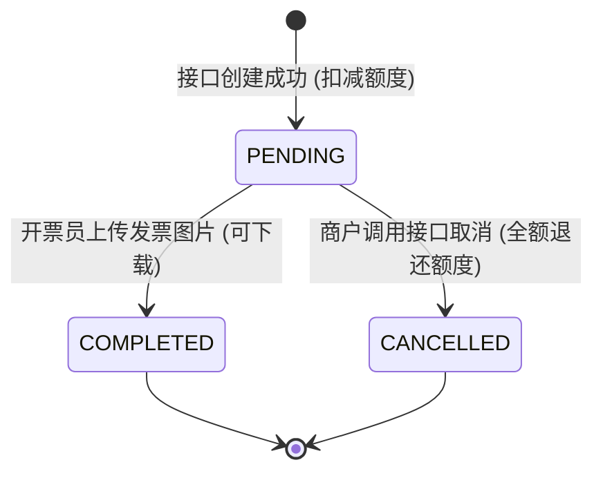
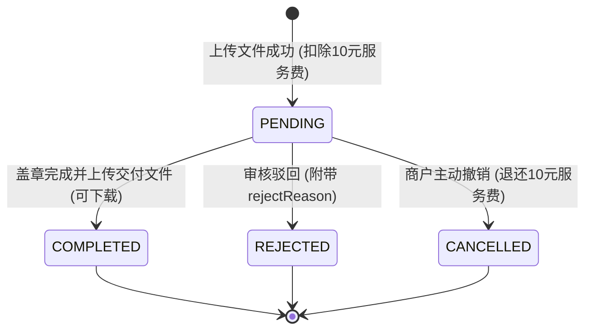

# BOBAPI 开放平台接口对接规范文档 (OpenAPI v1.0)

欢迎对接 **BOBAPI 发票与盖章管理系统** 开放接口！  
本文档面向外部商户、企业财务/ERP系统、自研中台等研发与系统对接人员，详细说明系统的通信协议、认证机制、业务规则、计费扣减模型、全量接口定义、异常处理标准以及典型编程语言的集成代码示例。

---

## 目录

- [1. 快速入门与接入准备](#1-快速入门与接入准备)
  - [1.1 接口基础信息](#11-接口基础信息)
  - [1.2 API Key 的获取与权限边界](#12-api-key-的获取与权限边界)
  - [1.3 通讯协议与通用规范](#13-通讯协议与通用规范)
- [2. 核心业务模型与计费扣减机制](#2-核心业务模型与计费扣减机制)
  - [2.1 发票预付费额度与扣减模型](#21-发票预付费额度与扣减模型)
  - [2.2 盖章独立服务费机制](#22-盖章独立服务费机制)
  - [2.3 状态流转与生命周期](#23-状态流转与生命周期)
  - [2.4 线上功能与 OpenAPI 范围说明](#24-线上功能与-openapi-范围说明)
- [3. 安全机制与高可用集成最佳实践](#3-安全机制与高可用集成最佳实践)
  - [3.1 外部商户订单号 (outTradeNo) 机制与对账](#31-外部商户订单号-outtradeno-机制与对账)
  - [3.2 幂等键 (Idempotency-Key) 机制与冲突处理](#32-幂等键-idempotency-key-机制与冲突处理)
  - [3.3 接口调用频率限制 (Rate Limit)](#33-接口调用频率限制-rate-limit)
  - [3.4 网络超时与重试建议](#34-网络超时与重试建议)
- [4. 全局返回格式与状态码规范](#4-全局返回格式与状态码规范)
  - [4.1 统一响应报文](#41-统一响应报文)
  - [4.2 业务状态码 (Code) 完整清单](#42-业务状态码-code-完整清单)
- [5. API 接口详细说明](#5-api-接口详细说明)
  - [5.1 额度查询接口](#51-额度查询接口)
    - [5.1.1 查询发票账户额度](#511-查询发票账户额度)
  - [5.2 发票管理接口](#52-发票管理接口)
    - [5.2.1 提交单笔开票申请](#521-提交单笔开票申请)
    - [5.2.2 批量提交开票申请 (最多100条/512KB)](#522-批量提交开票申请-最多100条512kb)
    - [5.2.3 按内部 ID 查询发票详情](#523-按内部-id-查询发票详情)
    - [5.2.4 按外部单号 (outTradeNo) 查询发票详情](#524-按外部单号-outtradeno-查询发票详情)
    - [5.2.5 按内部 ID 取消开票申请](#525-按内部-id-取消开票申请)
    - [5.2.6 按外部单号 (outTradeNo) 取消开票申请](#526-按外部单号-outtradeno-取消开票申请)
    - [5.2.7 按内部 ID 下载已开发票文件](#527-按内部-id-下载已开发票文件)
    - [5.2.8 按外部单号 (outTradeNo) 下载已开发票文件](#528-按外部单号-outtradeno-下载已开发票文件)
  - [5.3 文件盖章接口](#53-文件盖章接口)
    - [5.3.1 上传待盖章文件 (Multipart)](#531-上传待盖章文件-multipart)
    - [5.3.2 查询盖章文件列表](#532-查询盖章文件列表)
    - [5.3.3 撤销待盖章申请 (退还服务费)](#533-撤销待盖章申请-退还服务费)
    - [5.3.4 下载已盖章完成的文件](#534-下载已盖章完成的文件)
- [6. 多语言对接代码示例](#6-多语言对接代码示例)
  - [6.1 Python 示例 (单笔开票 + 状态轮询 + 文件下载)](#61-python-示例-单笔开票--状态轮询--文件下载)
  - [6.2 Java 11+ HttpClient 示例](#62-java-11-httpclient-示例)
  - [6.3 Node.js (Axios) 示例](#63-nodejs-axios-示例)
  - [6.4 cURL 命令行与脚本调用](#64-curl-命令行与脚本调用)
- [7. 常见问题排查与技术支持 (FAQ)](#7-常见问题排查与技术支持-faq)

---

## 1. 快速入门与接入准备

### 1.1 接口基础信息

| 配置项 | 说明 |
| :--- | :--- |
| **测试环境网关地址** | `http://<测试环境Host:Port>/api`（请联系平台管理员索取） |
| **生产环境网关地址** | `https://<生产环境域名>/api` |
| **OpenAPI 统一路径前缀** | `/api/open/v1` |
| **认证 Header** | `X-API-KEY: <您的API_KEY>`（大小写不敏感，亦支持 `X-Api-Key`） |
| **数据传输协议** | HTTPS / HTTP 1.1，字符集 `UTF-8`，报文内容格式 `application/json`（文件上传除外） |

> **⚠️ 重点注意：**
> 系统根路径配置了 `/api` 上下文。所有接口的完整请求路径必须以 `/api` 开头，例如创建发票的完整 URL 是：`https://<域名>/api/open/v1/invoices`。

### 1.2 API Key 的获取与权限边界

1. **获取途径**：
   - 商户用户登录 BOBAPI 发票系统 Web 界面，进入【个人中心】或【API Key 管理】。
   - 点击【生成 API Key】生成专属密钥，或由平台管理员在后台为该商户分配生成。
2. **权限隔离与安全**：
   - 每一个 API Key 与商户账户严格一对一绑定。通过该 Key 只能访问和操作**当前账号自身名下**的数据，无法跨租户越权（违规访问返回 `403`）。
   - API Key **仅在 `/api/open/**` 开放路径下生效**。若携带 API Key 请求后台管理接口或站内接口，将直接被安全过滤器拦截并按未登录处理（`401`）。
   - **安全建议**：严禁在前端 JavaScript、移动端 App 或公开仓库中明文硬编码 API Key，务必部署在后端服务端环境变量中。

### 1.3 通讯协议与通用规范

- **全链路追踪**：每次 HTTP 请求，系统会在响应报文的 `traceId` 字段以及 HTTP 响应头 `X-Trace-Id` 中返回唯一的 UUID。对接调试中遇到任何报错，可直接复制此追踪 ID 提交给平台支持人员。
- **金额精度与类型**：所有涉及金额的入参和出参，均以 **元（RMB）** 为单位，强制保留不超过两位小数（如 `100.00`），禁止使用浮点数，建议使用精确的字符串或 `BigDecimal` 序列化表示。

---

## 2. 核心业务模型与计费扣减机制

### 2.1 发票预付费额度与扣减模型

系统采用**先充值额度、后提开发票**的预付费模型。

#### 1. 额度折算基准
商户充值时采用 **3%（0.03）** 的基准手续费率反算可开票额度：
$$\text{获得额度} = \frac{\text{充值手续费}}{0.03} \quad (\text{向下取整到分})$$
*例如：对公转账支付手续费 30.00 元，平台管理员审核通过后，商户发票额度账户将到账 1,000.00 元。*

#### 2. 开票扣减额度规则
系统支持指定 **出票主体公司（`sellerCompany`）** 与 **发票票种（`invoiceCategory`）**，不同的组合对应不同的执行费率及实际扣除额度倍率：

| 出票主体 (`sellerCompany`) | 发票票种 (`invoiceCategory`) | 执行费率 | 额度扣除倍率计算公式 | 举例：申请开票 1,000.00 元 |
| :--- | :--- | :---: | :--- | :--- |
| **普通公司** (`DEFAULT`, 默认) | **普通发票** (`NORMAL`, 默认) | 3% (`0.0300`) | $\text{扣除额度} = \text{开票金额} \times 1.0$ | 扣除 **1,000.00** 额度 |
| **普通公司** (`DEFAULT`, 默认) | **增值税专用发票** (`VAT_SPECIAL`) | 9% (`0.0900`) | $\text{扣除额度} = \text{开票金额} \times 3.0$ | 扣除 **3,000.00** 额度 |
| **科技公司** (`TECH`) | **普通发票** (`NORMAL`, 默认) | 4% (`0.0400`) | $\text{扣除额度} = \text{开票金额} \times \frac{0.04}{0.03}$ | 扣除 **1,333.33** 额度 |
| **科技公司** (`TECH`) | **增值税专用发票** (`VAT_SPECIAL`) | 10% (`0.1000`) | $\text{扣除额度} = \text{开票金额} \times \frac{0.10}{0.03}$ | 扣除 **3,333.33** 额度 |

#### 3. 额度扣减与退还时机
- **扣减**：开票申请创建成功时，数据库行锁校验余额并**实时原子扣除**。若可用额度不足，事务完整回滚并返回 `40002`，不产生脏数据。
- **退还**：当发票处于 `PENDING`（待开票）状态时，商户通过接口或界面取消申请，系统**原路退还**创建时实际扣除的额度。

### 2.2 盖章独立服务费机制

- 盖章业务使用**独立的盖章额度账户**，与发票额度物理隔离。
- 单次上传待盖章文件固定扣除单次服务费 **10.00 元**。
- 仅当盖章申请处于 `PENDING` 状态时撤销，系统会自动退还 10.00 元服务费。
- 为保护商户隐私，OpenAPI 不暴露盖章额度余额查询，若上传时盖章额度不足，仅返回 `40002 盖章额度不足，请先充值`。

### 2.3 状态流转与生命周期

#### 发票业务状态流转 (`status`)

- `PENDING`（待开票）：申请已接收，额度已预扣，等待开票员开具发票。在此状态下**允许调用取消接口**。
- `COMPLETED`（已开票）：开票员已上传发票文件凭证（JPG/PNG）。此时字段 `downloadable = true`，商户可调用下载接口。**已开票状态不可取消**。
- `CANCELLED`（已取消）：开票申请已被撤回，对应额度已退还商户。

#### 盖章文件状态流转 (`status`)


### 2.4 线上功能与 OpenAPI 范围说明

- **发票红冲 (`redFlushStatus`)**：发票红冲涉及原票作废及税务核验，当前仅支持商户在 Web 界面人工发起。OpenAPI 的发票查询接口返回 `redFlushStatus`（`NONE` / `PENDING` / `COMPLETED` / `REJECTED`），便于客户系统感知红冲状态。
- **标记已处理 (`isProcessed`)**：属于 Web 界面用户端的数据筛选标记，不作为 OpenAPI 状态控制。

---

## 3. 安全机制与高可用集成最佳实践

### 3.1 外部商户订单号 (outTradeNo) 机制与对账

强烈建议在提交单笔发票申请时，传入客户系统自身的业务单号：`outTradeNo`（最大 100 字符）。
1. **全局唯一与防重**：数据库底层为 `(user_id, out_trade_no)` 建立了唯一索引。
2. **重试透明幂等**：若因网络抖动造成调用方未收到响应而发起重试，只要 `outTradeNo` 及请求报文内容完全一致，系统不会重复建单扣费，而是**直接返回初次创建成功的发票记录**。
3. **闭环操作能力**：系统针对 `outTradeNo` 提供了**查询状态**、**取消申请**、**下载发票**专属接口，商户系统无需本地持久化 BOBAPI 内部的自增发票 ID。

### 3.2 幂等键 (Idempotency-Key) 机制与冲突处理

系统通过请求头 `Idempotency-Key` 提供强幂等保护：
- **格式规范**：长度 16 ~ 64 位，字符集仅限数字、字母、点、下划线、冒号和连字符（正则：`^[A-Za-z0-9._:-]{16,64}$`）。
- **约束机制**：
  - 盖章文件上传接口（`POST /open/v1/documents`）**强制必传**此 Header。
  - 发票创建接口推荐传递。若未传，系统将自动使用 `open_<outTradeNo>` 作为幂等键兜底。
- **冲突判断与错误码**：
  - **内容被篡改**：同一商户使用相同的幂等键提交了不同的请求内容（金额、公司名称等不一致），系统抛出 HTTP `409 Conflict`（业务 Code: `40902` 发票，`40903` 盖章）。
  - **并发到达**：毫秒级同时到达的同幂等键并发请求，系统利用唯一索引排他防护，后到达的请求返回 `409`（业务 Code: `40904`），调用方稍候查询即可。

### 3.3 接口调用频率限制 (Rate Limit)

系统采用滑动窗口算法对商户维度进行频控防护。触发限流时返回 HTTP `429 Too Many Requests`，响应报文附带 `data`（需等待重试的秒数），同时响应头中附带标准 `Retry-After: <秒数>`。

| 接口分类 | 接口路径与方法 | 频控阈值 | 限流错误码 |
| :--- | :--- | :--- | :--- |
| **单笔发票提交** | `POST /api/open/v1/invoices` | **60 次 / 分钟** | `42902` |
| **批量发票提交** | `POST /api/open/v1/invoices/batch` | **20 次 / 分钟** | `42902` |
| **发票状态查询** | `GET /api/open/v1/invoices/*` | **120 次 / 分钟** | `42905` |
| **发票文件下载** | `GET /api/open/v1/invoices/*/download` | **120 次 / 分钟** | `42904` |
| **发票申请取消** | `POST /api/open/v1/invoices/*/cancel` | **30 次 / 分钟** | `42905` |
| **发票额度查询** | `GET /api/open/v1/quota` | **120 次 / 分钟** | `42907` |
| **盖章文件上传** | `POST /api/open/v1/documents` | **30 次 / 分钟** | `42901` |
| **盖章列表查询** | `GET /api/open/v1/documents` | **120 次 / 分钟** | `42905` |
| **盖章申请撤销** | `POST /api/open/v1/documents/{id}/cancel` | **30 次 / 分钟** | `42905` |
| **盖章交付下载** | `GET /api/open/v1/documents/{id}/download` | **120 次 / 分钟** | `42904` |

### 3.4 网络超时与重试建议

1. **客户端超时配置**：建议连接超时（Connect Timeout）设为 **5~10 秒**，读取超时（Read Timeout）设为 **15~30 秒**。
2. **发生超时时的正确做法**：
   - 当调用提交接口遭遇 SocketTimeoutException 或 HTTP 504 错误时，**切勿生成新的订单号重新调用**（否则可能导致多次扣额）。
   - 正确做法：使用原 `outTradeNo` 调用【按商户单号查询发票】接口：
     - 若已查到记录，说明前次请求已成功建单，直接使用；
     - 若返回 404，说明前次请求未到达系统，可使用原 `outTradeNo` 安全重试。

---

## 4. 全局返回格式与状态码规范

### 4.1 统一响应报文

除二进制流下载接口直接传输文件字节外，系统所有响应均采用统一的 JSON 包装：

```json
{
  "code": 200,
  "message": "success",
  "data": {},
  "traceId": "9f7b4946-b33a-44c1-845b-7b08219ab12e"
}
```

- `code`：业务状态码（整数），`200` 表示操作成功，非 200 详见下表。
- `message`：提示信息。
- `data`：响应载荷（对象、数组、基本数据类型或 null）。
- `traceId`：全局调用链追踪唯一标识。

### 4.2 业务状态码 (Code) 完整清单

| HTTP 状态 | 业务 Code | 说明与典型触发原因 | 处理策略 |
| :--- | :--- | :--- | :--- |
| `200 OK` | `200` | 操作成功 | 正常处理业务载荷 |
| `400 Bad Request` | `40001` | 参数校验不通过（缺失必填参数、参数格式或长度超出限制） | 检查并修正入参字段 |
| `400 Bad Request` | `40002` | 账户额度不足（发票可用额度不足，或盖章额度不足） | 前往平台充值额度 |
| `400 Bad Request` | `40003` | 业务字段规则非法（如开票类型不在允许白名单内、开票金额超过10位整数） | 检查发票票种、开票类型枚举 |
| `400 Bad Request` | `40007` | 上传了危险扩展名文件（包含 `.exe`, `.bat`, `.sh`, `.php` 等脚本或可执行文件） | 更换为合规的办公或图片文件 |
| `401 Unauthorized`| `40100` | 未提供身份凭证 | 检查请求是否带上认证信息 |
| `401 Unauthorized`| `40101` | 缺少 `X-API-KEY` 请求头，或 API Key 不存在/已被禁用 | 检查 Header 拼写并在控制台启用 Key |
| `403 Forbidden`   | `40300` | 权限拒绝 / 跨租户数据越权访问 | 禁止尝试操作其他商户账号的数据 |
| `403 Forbidden`   | `40301` | 资源归属校验失败（试图下载或取消其他账号的发票） | 确认请求所操作的单号归属自身 |
| `404 Not Found`   | `40401` | 发票申请记录或盖章记录不存在 | 检查查询的发票 ID 或商户订单号 |
| `404 Not Found`   | `40402` | 发票物理文件不存在或未上传完成 | 等待发票状态流转至 COMPLETED 再下载 |
| `409 Conflict`    | `40900` | 数据库并发乐观锁冲突 | 重新刷新数据后发起操作 |
| `409 Conflict`    | `40902` | 幂等冲突（发票 Idempotency-Key 已用于不同内容，或该单已被处理无法取消） | 检查是否篡改了重复提交的报文内容 |
| `409 Conflict`    | `40903` | 盖章 Idempotency-Key 已用于不同文件 | 为新文件生成全新 Idempotency-Key |
| `409 Conflict`    | `40904` | 相同 Idempotency-Key 的上传请求正在处理中 | 稍候调用列表接口查询上传结果 |
| `413 Payload Large`| `41300` | 单文件体积超限（发票上传限 10MB，盖章上传限 50MB） | 压缩后重新上传 |
| `413 Payload Large`| `41302` | 批量开票请求体 JSON 体积超过 **512KB** 限制 | 减少单次批量提交的记录数量 |
| `422 Unprocessable`| `42201` | 实体状态不支持该操作（例如：只能取消 PENDING 状态发票） | 确认发票当前状态是否满足前置条件 |
| `422 Unprocessable`| `42202` | 批量开票数据包含明细行校验错误（逐行校验失败） | 查看 `data` 数组中定位出错行与字段 |
| `429 Too Many Req`| `42901`~`42907` | 触发接口频控限制 | 获取响应中秒数，延迟后发起重试 |
| `500 Server Error`| `50000` | 系统处理异常 | 保留 `traceId` 联系平台技术人员 |

---

## 5. API 接口详细说明

### 5.1 额度查询接口

#### 5.1.1 查询发票账户额度

- **接口描述**：获取当前商户账号名下的发票额度余额、累计充值总额与累计消耗总额。
- **请求方式**：`GET`
- **请求路径**：`/api/open/v1/quota`
- **请求头**：
  - `X-API-KEY`：`string`（必填）

**响应示例**：
```json
{
  "code": 200,
  "message": "success",
  "data": {
    "balance": 52300.50,
    "totalRecharged": 100000.00,
    "totalDeducted": 47699.50
  },
  "traceId": "fa9d2b2c-3491-4d79-9014-5efc1c911001"
}
```

---

### 5.2 发票管理接口

#### 5.2.1 提交单笔开票申请

- **接口描述**：提交单张发票开具申请。系统实时原子校验额度并扣除。
- **请求方式**：`POST`
- **请求路径**：`/api/open/v1/invoices`
- **请求头**：
  - `X-API-KEY`：`string`（必填）
  - `Idempotency-Key`：`string`（可选，推荐传，16~64位）
  - `Content-Type`：`application/json`
- **请求体参数 (JSON Body)**：

| 字段名 | 类型 | 必填 | 默认值 | 约束说明 |
| :--- | :--- | :---: | :--- | :--- |
| `outTradeNo` | String | 否 | 无 | 外部商户订单号，同账号下唯一，最大 100 字符。**强烈推荐传入** |
| `companyName`| String | **是** | 无 | 开票抬头（购买方公司名称），最大 200 字符，不能为空 |
| `taxNumber`  | String | 否 | 无 | 纳税人识别号（税号），最大 100 字符，自动去除首尾空格并转大写 |
| `amount`     | BigDecimal | **是** | 无 | 开票金额（元），最小 `0.01`，最多 10 位整数和 2 位小数 |
| `invoiceType`| String | 否 | `技术服务费` | 开票类型。**严格白名单校验**，仅支持：<br>• `技术服务费`<br>• `AI订阅服务费`<br>• `计算服务费`<br>• `研发和技术服务` |
| `invoiceCategory`| String | 否 | `NORMAL` | 发票票种：<br>• `NORMAL`：普通发票（普票）<br>• `VAT_SPECIAL`：增值税专用发票（专票）<br>*(支持中文别名“普票/普通发票”、“专票/专用发票”)* |
| `sellerCompany` | String | 否 | `DEFAULT` | 出票主体公司：<br>• `DEFAULT`：普通公司（默认，普票1倍/专票3倍额度）<br>• `TECH`：科技公司（普票4/3倍/专票10/3倍额度）<br>*(支持中文别名“普通公司”、“科技公司”)* |
| `remark`     | String | 否 | 无 | 发票备注信息，最大 500 字符 |

**请求体示例**：
```json
{
  "outTradeNo": "ORDER_20261031_0001",
  "companyName": "北京科技有限公司",
  "taxNumber": "91110108MA00000000",
  "amount": 1000.00,
  "invoiceType": "技术服务费",
  "invoiceCategory": "NORMAL",
  "sellerCompany": "DEFAULT",
  "remark": "项目一期开发技术服务费"
}
```

**响应示例**：
```json
{
  "code": 200,
  "message": "申请成功",
  "data": {
    "id": 1024,
    "outTradeNo": "ORDER_20261031_0001",
    "companyName": "北京科技有限公司",
    "taxNumber": "91110108MA00000000",
    "amount": 1000.00,
    "invoiceType": "技术服务费",
    "invoiceCategory": "NORMAL",
    "sellerCompany": "DEFAULT",
    "feeRate": 0.0300,
    "deductedQuota": 1000.00,
    "remark": "项目一期开发技术服务费",
    "status": "PENDING",
    "submissionType": "API",
    "redFlushStatus": "NONE",
    "redFlushReason": null,
    "redFlushRemark": null,
    "redFlushApplyTime": null,
    "redFlushCompleteTime": null,
    "downloadable": false,
    "fileName": null,
    "createdAt": "2026-10-31T12:00:00",
    "completedAt": null
  },
  "traceId": "79b32943-4dc3-4a16-9285-1adbe3ce8c97"
}
```

---

#### 5.2.2 批量提交开票申请 (最多100条/512KB)

- **接口描述**：单次批量提交多张发票申请。具有**全局原子性**：批次中若任一行字段校验失败或商户总额度不足，**整批全部回滚**，不产生部分写入。
- **请求方式**：`POST`
- **请求路径**：`/api/open/v1/invoices/batch`
- **体积限制**：JSON 请求体大小不能超过 **512KB**（超限返回 `41302`）。
- **数量限制**：`items` 数组长度为 **1 ~ 100 条**（超限返回 `40001`）。
- **请求头**：
  - `X-API-KEY`：`string`（必填）
  - `Idempotency-Key`：`string`（可选，用于整批防重）
  - `Content-Type`：`application/json`
- **请求体参数**：

| 字段名 | 类型 | 必填 | 默认值 | 说明 |
| :--- | :--- | :---: | :--- | :--- |
| `duplicateInvoiceRequest` | Boolean | 否 | `false` | **重要开关**：同一批次内是否存在相同抬头与金额的发票。<br>• 设为 `false` 时：若批次内存在两行明细的内容完全一致，将报错 `该行与批次内其他行完全重复`；<br>• 设为 `true` 时：允许合法重复开票。 |
| `items` | Array | **是** | 无 | 发票明细对象列表（1 ~ 100 条） |

`items` 数组元素字段：
- `rowNumber`（Integer，可选）：客户端行号。若传入，必须 $\ge 1$ 且**批次内不可重复**。若不传，系统默认从 1 自增赋值。
- `companyName`（String，必填）：公司名称（$\le 200$ 字符）。
- `taxNumber`（String，可选）：纳税人识别号（$\le 100$ 字符）。
- `amount`（String，必填）：金额文本格式（如 `"1500.00"`），最多 10 位整数和 2 位小数。
- `invoiceType`（String，可选，默认 `技术服务费`）：开票类型白名单。
- `invoiceCategory`（String，可选，默认 `NORMAL`）：`NORMAL` 普票 / `VAT_SPECIAL` 专票。
- `sellerCompany`（String，可选，默认 `DEFAULT`）：`DEFAULT` 普通公司 / `TECH` 科技公司。
- `remark`（String，可选）：备注（$\le 500$ 字符）。

**请求体示例**：
```json
{
  "duplicateInvoiceRequest": false,
  "items": [
    {
      "rowNumber": 1,
      "companyName": "腾讯科技（深圳）有限公司",
      "taxNumber": "91440300708461136T",
      "amount": "5000.00",
      "invoiceType": "技术服务费",
      "invoiceCategory": "NORMAL",
      "sellerCompany": "DEFAULT"
    },
    {
      "rowNumber": 2,
      "companyName": "阿里巴巴（中国）网络技术有限公司",
      "taxNumber": "91330100716105852F",
      "amount": "2000.00",
      "invoiceType": "计算服务费",
      "invoiceCategory": "VAT_SPECIAL",
      "sellerCompany": "TECH"
    }
  ]
}
```

**成功响应示例 (`200 OK`)**：
```json
{
  "code": 200,
  "message": "批量申请成功",
  "data": {
    "batchId": 88,
    "total": 2,
    "successCount": 2,
    "failureCount": 0,
    "totalAmount": "7000.00",
    "items": [
      { "rowNumber": 1, "invoiceId": 1025, "status": "SUCCESS", "message": "申请成功" },
      { "rowNumber": 2, "invoiceId": 1026, "status": "SUCCESS", "message": "申请成功" }
    ]
  },
  "traceId": "9b12d7c0-141b-4e54-8545-80bf70f6cb3c"
}
```

**批量校验失败响应示例 (`422 Unprocessable Entity`)**：
```json
{
  "code": 42202,
  "message": "批量申请包含无效数据",
  "data": [
    {
      "rowNumber": 2,
      "field": "amount",
      "code": 42202,
      "message": "开票金额格式不正确，应为最多 10 位整数和 2 位小数"
    }
  ],
  "traceId": "6c459201-92be-49dc-8a21-9871638290ba"
}
```

---

#### 5.2.3 按内部 ID 查询发票详情

- **接口描述**：通过系统自增发票 ID 查询发票信息与状态。
- **请求方式**：`GET`
- **请求路径**：`/api/open/v1/invoices/{id}`
- **路径参数**：`id`（发票 ID）

---

#### 5.2.4 按外部单号 (outTradeNo) 查询发票详情

- **接口描述**：通过商户自身传递的 `outTradeNo` 查询发票状态与详细信息。（**推荐业务系统轮询使用**）
- **请求方式**：`GET`
- **请求路径**：`/api/open/v1/invoices/by-out-trade-no/{outTradeNo}`
- **路径参数**：`outTradeNo`（商户订单号）

**响应示例**：
```json
{
  "code": 200,
  "message": "success",
  "data": {
    "id": 1024,
    "outTradeNo": "ORDER_20261031_0001",
    "companyName": "北京科技有限公司",
    "taxNumber": "91110108MA00000000",
    "amount": 1000.00,
    "invoiceType": "技术服务费",
    "invoiceCategory": "NORMAL",
    "sellerCompany": "DEFAULT",
    "feeRate": 0.0300,
    "deductedQuota": 1000.00,
    "status": "COMPLETED",
    "downloadable": true,
    "fileName": "invoice_1024.png",
    "createdAt": "2026-10-31T12:00:00",
    "completedAt": "2026-10-31T12:15:30"
  },
  "traceId": "8b08219a-b12e-4f0b-b4d1-b74735c02967"
}
```

---

#### 5.2.5 按内部 ID 取消开票申请

- **接口描述**：取消未开出的发票申请。仅允许在发票处于 `PENDING` 状态时调用，取消成功后系统即时退还原路扣除的额度。
- **请求方式**：`POST`
- **请求路径**：`/api/open/v1/invoices/{id}/cancel`

---

#### 5.2.6 按外部单号 (outTradeNo) 取消开票申请

- **接口描述**：通过商户订单号取消发票申请，自动退还扣除额度。
- **请求方式**：`POST`
- **请求路径**：`/api/open/v1/invoices/by-out-trade-no/{outTradeNo}/cancel`
- **路径参数**：`outTradeNo`（商户订单号）

**响应示例**：
```json
{
  "code": 200,
  "message": "取消成功",
  "data": {
    "id": 1024,
    "outTradeNo": "ORDER_20261031_0001",
    "status": "CANCELLED"
  },
  "traceId": "48b1d40c-e208-4c6c-99a6-d36e2f7b4946"
}
```

---

#### 5.2.7 按内部 ID 下载已开发票文件

- **接口描述**：获取开具完成的发票图片文件流。必须在 `status == "COMPLETED"` 且 `downloadable == true` 时才能成功下载。
- **请求方式**：`GET`
- **请求路径**：`/api/open/v1/invoices/{id}/download`
- **响应头**：
  - `Content-Disposition: attachment; filename="<fileName>"`
  - `Content-Type: image/jpeg` 或 `image/png`
  - `X-Content-Type-Options: nosniff`
- **响应载荷**：图片二进制流

---

#### 5.2.8 按外部单号 (outTradeNo) 下载已开发票文件

- **接口描述**：通过商户订单号下载已开具的发票文件。（**推荐直接使用商户单号下载**）
- **请求方式**：`GET`
- **请求路径**：`/api/open/v1/invoices/by-out-trade-no/{outTradeNo}/download`
- **路径参数**：`outTradeNo`（商户订单号）

---

### 5.3 文件盖章接口

#### 5.3.1 上传待盖章文件 (Multipart)

- **接口描述**：上传需要物理加盖公章的合同、证明或协议文件。上传成功后系统前置扣减 **10.00 元** 独立盖章额度。
- **请求方式**：`POST`
- **请求路径**：`/api/open/v1/documents`
- **Content-Type**：`multipart/form-data`
- **请求头**：
  - `X-API-KEY`：`string`（必填）
  - `Idempotency-Key`：`string`（**必填**，16~64位唯一键）
- **请求参数 (Form Data)**：
  - `file`：待盖章文件二进制，文件大小 $\le 50\text{MB}$。
- **扩展名安全黑名单**：
  系统严禁上传以下高危程序与脚本文件（命中将返回 `40007`）：  
  `exe`, `bat`, `sh`, `cmd`, `ps1`, `vbs`, `msi`, `dll`, `com`, `scr`, `jsp`, `jspx`, `php`, `asp`, `aspx`。
- **文件防重特性**：
  同一商户使用相同的 `Idempotency-Key` 重复上传内容、大小及 SHA-256 完全一致的文件，系统直接返回首次上传记录，**不重复扣费**。

**响应示例**：
```json
{
  "code": 200,
  "message": "文件上传成功，等待盖章处理",
  "data": {
    "id": 56,
    "sourceFileName": "劳动合同及保密协议.pdf",
    "sourceFileSize": 2048560,
    "sourceFileExt": "pdf",
    "feeAmount": 10.00,
    "status": "PENDING",
    "rejectReason": null,
    "downloadable": false,
    "sealedFileName": null,
    "sealedFileSize": null,
    "createdAt": "2026-10-31T12:30:00",
    "completedAt": null,
    "updatedAt": "2026-10-31T12:30:00"
  },
  "traceId": "c33f2022-d4f5-4e1b-b886-47573e34b9d1"
}
```

---

#### 5.3.2 查询盖章文件列表

- **接口描述**：查询当前账号名下提交的盖章申请列表。
- **请求方式**：`GET`
- **请求路径**：`/api/open/v1/documents`
- **Query 查询参数**：
  - `status`（可选）：状态筛选。可选值：`PENDING`（待盖章）、`COMPLETED`（已完成）、`REJECTED`（已驳回）、`CANCELLED`（已撤销）、`ALL`（全部）。默认返回全部。

**响应示例**：
```json
{
  "code": 200,
  "message": "success",
  "data": [
    {
      "id": 56,
      "sourceFileName": "劳动合同及保密协议.pdf",
      "sourceFileSize": 2048560,
      "sourceFileExt": "pdf",
      "feeAmount": 10.00,
      "status": "COMPLETED",
      "rejectReason": null,
      "downloadable": true,
      "sealedFileName": "劳动合同及保密协议_已盖章.pdf",
      "sealedFileSize": 2150000,
      "createdAt": "2026-10-31T12:30:00",
      "completedAt": "2026-10-31T12:45:00",
      "updatedAt": "2026-10-31T12:45:00"
    }
  ],
  "traceId": "9e1bc81d-6f51-4b7e-80d4-0e4ab58632e8"
}
```

---

#### 5.3.3 撤销待盖章申请 (退还服务费)

- **接口描述**：撤销处于 `PENDING` 状态的盖章申请，系统自动退回已扣除的 10.00 元盖章服务费。
- **请求方式**：`POST`
- **请求路径**：`/api/open/v1/documents/{id}/cancel`
- **路径参数**：`id`（盖章申请 ID）

**响应示例**：
```json
{
  "code": 200,
  "message": "申请已撤销，服务费已退回",
  "data": {
    "id": 56,
    "status": "CANCELLED"
  },
  "traceId": "50e42823-1d02-4fc7-b12a-3c4f74d0823c"
}
```

---

#### 5.3.4 下载已盖章完成的文件

- **接口描述**：下载盖章处理完毕的交付文件。仅在 `status == "COMPLETED"` 时可用。
- **请求方式**：`GET`
- **请求路径**：`/api/open/v1/documents/{id}/download`
- **路径参数**：`id`（盖章申请 ID）
- **响应载荷**：盖章交付文件二进制流

---

## 6. 多语言对接代码示例

### 6.1 Python 示例 (单笔开票 + 状态轮询 + 文件下载)

```python
#!/usr/bin/env python3
# -*- coding: utf-8 -*-
import time
import requests

BASE_URL = "https://your-domain.com/api"
API_KEY = "your-actual-api-key"

headers = {
    "X-API-KEY": API_KEY,
    "Content-Type": "application/json"
}

def submit_invoice(out_trade_no: str, company_name: str, tax_no: str, amount: float):
    """提交发票申请"""
    url = f"{BASE_URL}/open/v1/invoices"
    payload = {
        "outTradeNo": out_trade_no,
        "companyName": company_name,
        "taxNumber": tax_no,
        "amount": amount,
        "invoiceType": "技术服务费",  # 必须在白名单内
        "invoiceCategory": "NORMAL", # NORMAL-普票, VAT_SPECIAL-专票
        "sellerCompany": "DEFAULT",  # DEFAULT-普通公司, TECH-科技公司
        "remark": "2026年技术服务费结算"
    }
    
    # 推荐携带幂等键
    req_headers = dict(headers)
    req_headers["Idempotency-Key"] = f"idem_{out_trade_no}"
    
    resp = requests.post(url, json=payload, headers=req_headers, timeout=15)
    result = resp.json()
    if resp.status_code == 200 and result.get("code") == 200:
        print(f"[+] 开票申请提交成功! 内部ID={result['data']['id']}, 扣除额度={result['data']['deductedQuota']}")
        return result["data"]
    else:
        raise RuntimeError(f"[-] 提交失败: HTTP {resp.status_code}, 详情: {result}")

def poll_and_download(out_trade_no: str, save_image_path: str, max_retry=30, interval=10):
    """轮询开票状态并下载文件"""
    query_url = f"{BASE_URL}/open/v1/invoices/by-out-trade-no/{out_trade_no}"
    download_url = f"{BASE_URL}/open/v1/invoices/by-out-trade-no/{out_trade_no}/download"
    
    for i in range(max_retry):
        resp = requests.get(query_url, headers=headers, timeout=10)
        res = resp.json()
        if res.get("code") == 200:
            invoice = res["data"]
            status = invoice["status"]
            print(f"[*] 第 {i+1} 次检查发票 [{out_trade_no}] 状态: {status}")
            
            if status == "COMPLETED" and invoice.get("downloadable"):
                print("[+] 发票已开具完成，准备下载文件...")
                dl_resp = requests.get(download_url, headers={"X-API-KEY": API_KEY}, stream=True, timeout=30)
                if dl_resp.status_code == 200:
                    with open(save_image_path, "wb") as f:
                        for chunk in dl_resp.iter_content(chunk_size=8192):
                            f.write(chunk)
                    print(f"[+] 发票文件下载成功，保存至: {save_image_path}")
                    return True
                else:
                    print(f"[-] 下载接口响应异常: {dl_resp.status_code}")
                    return False
            elif status == "CANCELLED":
                print("[-] 发票申请已被取消")
                return False
        
        time.sleep(interval)
        
    print("[-] 轮询已达最大次数，开票仍在处理中，稍后可继续查询")
    return False

if __name__ == "__main__":
    order_no = f"MCH_{int(time.time())}"
    submit_invoice(order_no, "某某软件研发科技有限公司", "91110000XXXXXXXXXX", 1000.00)
    poll_and_download(order_no, f"{order_no}.png")
```

---

### 6.2 Java 11+ HttpClient 示例

```java
package com.example.invoice;

import java.net.URI;
import java.net.http.HttpClient;
import java.net.http.HttpRequest;
import java.net.http.HttpResponse;
import java.nio.file.Path;
import java.nio.file.StandardOpenOption;
import java.time.Duration;

public class BobapiInvoiceClient {

    private static final String BASE_URL = "https://your-domain.com/api";
    private static final String API_KEY = "your-actual-api-key";

    private final HttpClient httpClient = HttpClient.newBuilder()
            .connectTimeout(Duration.ofSeconds(10))
            .build();

    /**
     * 提交单笔发票申请
     */
    public String createInvoice(String outTradeNo, String companyName, String taxNumber, double amount) throws Exception {
        String jsonPayload = String.format("""
                {
                  "outTradeNo": "%s",
                  "companyName": "%s",
                  "taxNumber": "%s",
                  "amount": %.2f,
                  "invoiceType": "技术服务费",
                  "invoiceCategory": "NORMAL",
                  "sellerCompany": "DEFAULT"
                }
                """, outTradeNo, companyName, taxNumber, amount);

        HttpRequest request = HttpRequest.newBuilder()
                .uri(URI.create(BASE_URL + "/open/v1/invoices"))
                .header("Content-Type", "application/json; charset=UTF-8")
                .header("X-API-KEY", API_KEY)
                .header("Idempotency-Key", "idemp_" + outTradeNo)
                .POST(HttpRequest.BodyPublishers.ofString(jsonPayload))
                .build();

        HttpResponse<String> response = httpClient.send(request, HttpResponse.BodyHandlers.ofString());
        return response.body();
    }

    /**
     * 根据商户订单号下载已开发票文件
     */
    public void downloadInvoice(String outTradeNo, Path savePath) throws Exception {
        HttpRequest request = HttpRequest.newBuilder()
                .uri(URI.create(BASE_URL + "/open/v1/invoices/by-out-trade-no/" + outTradeNo + "/download"))
                .header("X-API-KEY", API_KEY)
                .GET()
                .build();

        HttpResponse<Path> response = httpClient.send(request, HttpResponse.BodyHandlers.ofFile(
                savePath, StandardOpenOption.CREATE, StandardOpenOption.WRITE));
        
        if (response.statusCode() == 200) {
            System.out.println("发票文件成功保存至: " + savePath.toAbsolutePath());
        } else {
            System.err.println("下载失败，HTTP 状态码: " + response.statusCode());
        }
    }
}
```

---

### 6.3 Node.js (Axios) 示例

```javascript
const axios = require('axios');
const fs = require('fs');

const apiClient = axios.create({
  baseURL: 'https://your-domain.com/api',
  headers: {
    'X-API-KEY': 'your-actual-api-key',
    'Content-Type': 'application/json'
  },
  timeout: 15000
});

async function main() {
  const outTradeNo = 'NODE_ORD_' + Date.now();

  try {
    // 1. 提交开票申请
    console.log(`正在提交开票: ${outTradeNo}`);
    const createRes = await apiClient.post('/open/v1/invoices', {
      outTradeNo: outTradeNo,
      companyName: '深圳某某智能科技有限公司',
      taxNumber: '91440300XXXXXXXXXX',
      amount: 2500.00,
      invoiceType: '技术服务费',
      invoiceCategory: 'NORMAL',
      sellerCompany: 'DEFAULT',
      remark: 'API对接测试发票'
    }, {
      headers: { 'Idempotency-Key': 'idemp_' + outTradeNo }
    });

    console.log('申请结果:', createRes.data);

    // 2. 查询账户当前额度
    const quotaRes = await apiClient.get('/open/v1/quota');
    console.log('当前账户额度剩余:', quotaRes.data.data.balance);

  } catch (err) {
    if (err.response) {
      console.error('业务异常响应:', err.response.status, err.response.data);
    } else {
      console.error('网络通讯错误:', err.message);
    }
  }
}

main();
```

---

### 6.4 cURL 命令行与脚本调用

#### 1. 查询商户可用开票额度
```bash
curl -X GET "https://your-domain.com/api/open/v1/quota" \
     -H "X-API-KEY: your-actual-api-key"
```

#### 2. 提交开票申请
```bash
curl -X POST "https://your-domain.com/api/open/v1/invoices" \
     -H "X-API-KEY: your-actual-api-key" \
     -H "Idempotency-Key: idemp_curl_20261031_001" \
     -H "Content-Type: application/json" \
     -d '{
       "outTradeNo": "CURL_ORD_20261031_001",
       "companyName": "上海某某科技有限公司",
       "taxNumber": "91310000XXXXXXXXXX",
       "amount": 1888.88,
       "invoiceType": "技术服务费",
       "invoiceCategory": "NORMAL"
     }'
```

#### 3. 按商户单号下载发票图片
```bash
curl -X GET "https://your-domain.com/api/open/v1/invoices/by-out-trade-no/CURL_ORD_20261031_001/download" \
     -H "X-API-KEY: your-actual-api-key" \
     --output "invoice_download.png"
```

#### 4. 上传待盖章文件 (Multipart Form Data)
```bash
curl -X POST "https://your-domain.com/api/open/v1/documents" \
     -H "X-API-KEY: your-actual-api-key" \
     -H "Idempotency-Key: seal_idemp_20261031_001" \
     -F "file=@/path/to/contract.pdf"
```

---

## 7. 常见问题排查与技术支持 (FAQ)

### Q1: 提示 `40101 缺少 X-API-KEY 请求头` 或 `API Key 无效或未启用`？
- **排查步骤**：
  1. 确认 HTTP Header 属性名为 `X-API-KEY`（或 `X-Api-Key`）。
  2. 确认登录 Web 控制台查看此 Key 是否处于开启状态。
  3. 确认请求 URL 是否以 `/api/open/` 开头。若使用 API Key 访问站内接口（如 `/api/invoices`），系统会主动拒绝并返回 401。

### Q2: 提示 `40002 额度不足`？
- **普通开票额度不足**：商户可用开票余额小于本次开票所需扣减的额度。
  - 请注意专票扣减倍率：普通主体专票按 **3 倍** 扣额，科技主体专票按 **10/3 倍** 扣额。
  - 处理方式：请在 Web 界面【额度充值】提交充值申请并完成对公转账，管理员审核通过后额度将自动入账。
- **盖章额度不足**：盖章业务扣除独立的盖章额度（10 元/次），需单独申请充值盖章额度。

### Q3: 提示 `40003 开票类型必须为：技术服务费、AI订阅服务费...`？
- 系统服务端对 `invoiceType` 设有严格白名单校验，必须为以下四种之一（完全匹配）：
  - `技术服务费`（默认）
  - `AI订阅服务费`
  - `计算服务费`
  - `研发和技术服务`

### Q4: 批量开票时提示 `42202 该行与批次内其他行完全重复`？
- 批量申请接口默认开启批内防重保护（`duplicateInvoiceRequest = false`）。若您在同一批次中意图开具抬头、税号、金额、类型均完全相同的多张发票，请在请求体顶层设置 `"duplicateInvoiceRequest": true`。

### Q5: 批量开票请求返回 `41302 批量请求体不能超过 512KB`？
- 批量接口单次请求 JSON 文本上限为 **512KB**。如需提交大量明细，建议拆分为多个批次提交，且单批次总条数不能超过 100 条。

### Q6: 发票开具完成后如何获取？
- 系统开票流程为异步流转（由人工开票员在后台完成开票与票件上传）。
- **推荐轮询频率**：提交开票申请后，启动定时轮询任务（建议每隔 **30秒 ~ 1分钟** 调用一次 `GET /api/open/v1/invoices/by-out-trade-no/{outTradeNo}`）。
- 当查询返回的 `status == "COMPLETED"` 且 `downloadable == true` 时，即可调用下载接口保存发票文件。
